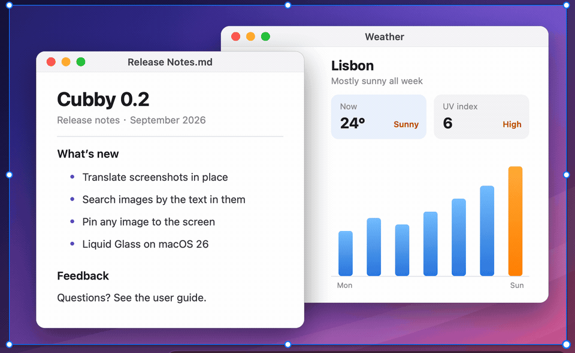

<p align="center">
  
</p>

<h1 align="center">Cubby</h1>

<p align="center">
  <b>Alles, was du kopierst, nur einen Tastendruck entfernt.</b><br>
  Ein nativer, auf die Tastatur ausgelegter Zwischenablage-Manager für macOS, der deinen Mac nie verlässt.
</p>

<p align="center">
  <a href="LICENSE"></a>
  
  
</p>

<p align="center">
  <a href="README.md">English</a> · <a href="README.zh-Hans.md">简体中文</a> · <a href="README.zh-Hant.md">繁體中文</a> · <a href="README.ja.md">日本語</a> · <a href="README.es.md">Español</a> · <b>Deutsch</b> · <a href="README.fr.md">Français</a>
</p>

```sh
brew install --cask no1coder/tap/cubby
```

Oder lade das notarisierte DMG unter [Releases](https://github.com/no1coder/cubby/releases/latest) herunter. Erfordert macOS 14 oder neuer, Apple Silicon oder Intel.

<p align="center">
  <picture>
    <source media="(prefers-color-scheme: dark)" srcset="docs/assets/screenshots/panel-dark.png">
    <source media="(prefers-color-scheme: light)" srcset="docs/assets/screenshots/panel-light.png">
    
  </picture>
</p>

Cubby wohnt in deiner Menüleiste und merkt sich, was du kopierst: Text, Links, Code, Farben, Bilder und Dateien. Drück <kbd>⇧⌘V</kbd>, tippe ein paar Buchstaben und drück <kbd>↩</kbd>, um in die App einzufügen, in der du gerade warst – ganz ohne Maus. Gedacht ist Cubby für alle, die den ganzen Tag kopieren und einfügen (Entwickler, Designerinnen, Autoren, alle, die mit Adressen und Textbausteinen jonglieren) und ein schnelles Werkzeug wollen, das ihre Privatsphäre respektiert. Dein Verlauf bleibt verschlüsselt auf deinem Mac; Cubby geht nur online, um nach einer neuen Version zu suchen (einmal täglich, abschaltbar) oder um mit einem Sprachmodell zu übersetzen, das du selbst eingerichtet hast.

**Highlights**

- **Sofort suchen und einfügen.** Eigene Karten für Links, Code, Farben und Dateien, eine Suche, die auch Text in Bildern liest, und Einfügen mit <kbd>↩</kbd> oder <kbd>⌘1</kbd>–<kbd>⌘9</kbd>.
- **Dein Layout.** Ein schwebendes Panel, eine am rechten Rand angedockte Seitenleiste oder eine Kartenleiste am unteren Rand; dazu ein reines Bilderraster auf <kbd>⌃⇧V</kbd>.
- **Bildschirmfotos und Markierungen.** <kbd>⇧⌘2</kbd> nimmt ein Fenster oder einen Bereich auf, lässt dich Anmerkungen ergänzen und legt das Ergebnis in deinem Verlauf ab.
- **Die Wäscheleine.** Häng bis zu 12 Bilder oben am Bildschirm auf und zieh sie bei Bedarf aus der Menüleiste herunter.
- **Adressschutz.** Du wirst gewarnt, wenn Schadsoftware eine kopierte Krypto-Adresse oder Kartennummer austauscht.
- **Übersetzung unter macOS 26.** Übersetze Einträge der Zwischenablage und Bildschirmfotos direkt an Ort und Stelle, auf dem Gerät oder mit deinem eigenen Modell.

## So sieht es aus

<table>
  <tr>
    <td align="center" width="50%">
      <br>
      <sub><b>Suchen und einfügen.</b> Tippen zum Finden, <kbd>↩</kbd> zum Einfügen.</sub>
    </td>
    <td align="center" width="50%">
      <br>
      <sub><b>Wäscheleine.</b> Zieh aus der Menüleiste nach unten, um an deine angehefteten Bilder zu kommen.</sub>
    </td>
  </tr>
  <tr>
    <td align="center" width="50%">
      <br>
      <sub><b>Bildschirmfoto und Markierungen.</b> Aufnehmen, beschriften, einfügen.</sub>
    </td>
    <td align="center" width="50%">
      <br>
      <sub><b>Adressschutz.</b> Eine ausgetauschte Adresse fällt auf, bevor du sie einfügst.</sub>
    </td>
  </tr>
  <tr>
    <td align="center" colspan="2">
      <br>
      <sub><b>Bildschirmfoto-Übersetzung (macOS 26).</b> <kbd>⇧⌘T</kbd> ersetzt den Text direkt an Ort und Stelle, das Layout bleibt erhalten; zum Vergleichen die Trennlinie ziehen.</sub>
    </td>
  </tr>
</table>

## Funktionen

**Erfassen und finden**

- Speichert Text (formatierter Text behält seine RTF-/HTML-Formatierung), Links, HEX-Farben, Bilder und Dateien. Kopierst du etwas erneut, rückt es wieder nach oben. Favoriten verfallen nie; alles andere wird auf ein Limit deiner Wahl gekürzt (50 – 2.000 Einträge, standardmäßig 500).
- Karten sehen aus wie ihr Inhalt: Links zeigen Seitentitel und vollständige Adresse, Code zeigt seine Sprache mit Syntaxhervorhebung, Farben zeigen HEX- und rgb()-Werte, Bilder das ganze Bild. Jede Karte zeigt die Quell-App, die Uhrzeit und ihre <kbd>⌘</kbd>-Nummer, gruppiert nach Today, Yesterday und Earlier (Heute, Gestern, Früher).
- Einfach lostippen, um zu suchen. Jedes Wort muss passen, Treffer werden hervorgehoben, die besten stehen oben, und jede Kategorie zeigt, wie viele Einträge passen. Auch Dateipfade, Quell-Apps, Linktitel und Text in Bildern (auf deinem Mac erkannt) sind durchsuchbar.
- Mit <kbd>⇥</kbd> nach Text, Links, Images, Files, Colors oder Favorites filtern. <kbd>Leertaste</kbd> öffnet eine seitliche Vorschau; <kbd>⌘B</kbd> (Pick Words) zerlegt einen Text in Wort-Chips, damit du nur den Teil einfügst, den du brauchst.
- Fünf Panel-Positionen: neben dem Zeiger, unter dem Menüleistensymbol, zentriert, am rechten Rand als Seitenleiste in voller Höhe oder am unteren Rand als Kartenleiste. <kbd>⌃⇧V</kbd> öffnet nur deine Bilder in einem Raster. Erscheinungsbild Hell, Dunkel oder wie das System; Liquid Glass unter macOS 26.

**Einfügen**

- <kbd>↩</kbd> fügt in die zuletzt benutzte App ein (die Fußzeile zeigt, welche), <kbd>⇧↩</kbd> fügt im jeweils anderen Format ein (Original ↔ reiner Text), <kbd>⌘↩</kbd> kopiert nur.
- <kbd>⌘1</kbd> – <kbd>⌘9</kbd> fügen einen der ersten neun Einträge ein; jede Karte lässt sich in eine andere App ziehen.
- Fahr mit dem Zeiger über eine Karte, um sie zu favorisieren, in der Vorschau zu zeigen, zu löschen oder anzuheften. <kbd>⌘⌫</kbd> löscht, <kbd>⌘Z</kbd> holt sie zurück.

**Bildschirmfotos**

- <kbd>⇧⌘2</kbd> friert den Bildschirm ein: Zeiger über ein Fenster bewegen, um es auszuwählen (<kbd>⇥</kbd> oder Scrollen wechselt durch überlappende Fenster), einen Bereich aufziehen oder <kbd>Leertaste</kbd> drücken für eine saubere Aufnahme nur eines Fensters samt Schatten.
- Beschrifte mit Rechtecken, Ellipsen, Pfeilen, Stift, Textmarker, Mosaik, Text und nummerierten Schritten – alles bleibt bis zum Abschluss bearbeitbar.
- Das Ergebnis wird kopiert **und in deinem Verlauf gespeichert**. Du kannst es auch auf dem Bildschirm anheften, als PNG sichern oder seinen Text per OCR auf dem Gerät extrahieren. Eine Lupe kopiert mit <kbd>C</kbd> die Farbe unter dem Zeiger.

**Wäscheleine**

- Drück <kbd>⌘L</kbd> auf einem Bild, um es an eine Leine oben am Bildschirm zu hängen (bis zu 12). Zum Herablassen ziehst du von einer freien Stelle der Menüleiste nach unten, lässt den Zeiger am oberen Rand ruhen, drückst <kbd>⌃⌥T</kbd> oder nutzt das Menü.
- Doppelklick auf ein Foto kopiert es; du kannst es auch in eine App ziehen oder anklicken, um es zu vergrößern und zu beschriften. **Done & Hang Back** (Fertig & zurückhängen) speichert das Ergebnis als neuen Eintrag und behält das Original. Fotos auf der Leine überstehen das Kürzen des Verlaufs.

**Adressschutz**

- Wird eine kopierte Bitcoin-, Ethereum-/EVM-, TRON-, Solana- oder Litecoin-Adresse oder eine Bankkartennummer innerhalb weniger Sekunden in der Zwischenablage ersetzt, während dieselbe App im Vordergrund bleibt, vergleicht eine Warnung beide Werte Zeichen für Zeichen und markiert die Unterschiede rot. **Restore What I Copied** (Kopiertes wiederherstellen) stellt deinen Wert wieder her.
- Der ersetzende Eintrag wird in deinem Verlauf rot markiert und lässt sich weder einfügen noch kopieren oder ziehen. Fügst du eine Adresse aus Cubby ein, prüft Cubby vorher, ob die Zwischenablage noch übereinstimmt.
- Die Zwischenablage wird nie geleert und <kbd>⌘V</kbd> nie abgefangen. Einstellen lässt sich das unter Settings › Security (Einstellungen › Sicherheit).

**Übersetzung** (macOS 26)

- <kbd>⌘T</kbd> übersetzt den ausgewählten Eintrag in einer Karte neben dem Panel; <kbd>⌥↩</kbd> übersetzt und fügt in einem Schritt ein; halte <kbd>⌥</kbd> gedrückt, um eine Übersetzung in der Liste vorab zu sehen.
- <kbd>⇧⌘T</kbd> übersetzt in einem Bildschirmfoto den Text direkt an Ort und Stelle, Block für Block.
- Nutzt standardmäßig Apples Übersetzung auf dem Gerät oder ein beliebiges OpenAI-kompatibles Modell, das du einrichtest (DeepSeek, Qwen, Kimi, Zhipu GLM, OpenAI, OpenRouter, ein lokales Ollama oder eine eigene URL). Siehe [Übersetzung](#übersetzung).

**Datenschutz und Feinschliff**

- Nur lokal und mit einem Schlüssel aus deinem Anmeldeschlüsselbund verschlüsselt, von Time Machine ausgeschlossen, keine Analyse oder Telemetrie. Ignoriert Inhalte aus Passwortmanagern, Apps, die du ausschließt, und Text, der wie ein API-Schlüssel, privater Schlüssel oder JWT aussieht. Die Aufzeichnung lässt sich jederzeit pausieren. Siehe [Datenschutz](#datenschutz).
- Swift 6 mit SwiftUI und AppKit, keine Abhängigkeiten von Drittanbietern, Universal-Binary. Nur in der Menüleiste, kein Dock-Symbol. Oberfläche auf Englisch und vereinfachtem Chinesisch. Funktioniert mit VoiceOver, „Bewegung reduzieren“ und „Kontrast erhöhen“.
- Ein kleiner blauer Punkt am Menüleistensymbol zeigt dir, wenn eine neue Version erschienen ist.

## Design

Die Oberfläche von v0.3 wurde zuerst als Satz von Entwürfen gestaltet und dann gebaut. Sie sind hier mit chinesischer Oberfläche zu sehen, und manche Details haben sich bei der Umsetzung geändert; das [Benutzerhandbuch](docs/USER-GUIDE.md) beschreibt die ausgelieferte App. Alle Entwürfe liegen in [docs/design/ui-upgrade](docs/design/ui-upgrade).

<table>
  <tr>
    <td align="center" width="33%">
      <picture>
        <source media="(prefers-color-scheme: light)" srcset="docs/design/ui-upgrade/MainLight.png">
        
      </picture><br>
      <sub>Schwebendes Panel mit eigenen Kartentypen</sub>
    </td>
    <td align="center" width="33%">
      <br>
      <sub>Suche, keine Ergebnisse und leere Zustände</sub>
    </td>
    <td align="center" width="33%">
      <picture>
        <source media="(prefers-color-scheme: light)" srcset="docs/design/ui-upgrade/ImageGridLight.png">
        
      </picture><br>
      <sub>Nur Bilder (<kbd>⌃⇧V</kbd>)</sub>
    </td>
  </tr>
</table>

<table>
  <tr>
    <td align="center" width="50%">
      <picture>
        <source media="(prefers-color-scheme: light)" srcset="docs/design/ui-upgrade/DockRightLight.png">
        
      </picture><br>
      <sub>Am rechten Rand angedockt</sub>
    </td>
    <td align="center" width="50%">
      <picture>
        <source media="(prefers-color-scheme: light)" srcset="docs/design/ui-upgrade/DockBottomLight.png">
        
      </picture><br>
      <sub>Am unteren Rand angedockt</sub>
    </td>
  </tr>
  <tr>
    <td align="center" width="50%">
      <picture>
        <source media="(prefers-color-scheme: light)" srcset="docs/design/ui-upgrade/ClotheslineLight.png">
        
      </picture><br>
      <sub>Die Wäscheleine</sub>
    </td>
    <td align="center" width="50%">
      <br>
      <sub>Ein Foto von der Leine beschriften</sub>
    </td>
  </tr>
  <tr>
    <td align="center" width="50%">
      <br>
      <sub>Warnung des Adressschutzes</sub>
    </td>
    <td align="center" width="50%">
      <br>
      <sub>Seitliche Vorschau (Leertaste)</sub>
    </td>
  </tr>
</table>

<table>
  <tr>
    <td align="center" width="33%">
      <br>
      <sub>Einführung in vier Schritten</sub>
    </td>
    <td align="center" width="33%">
      <picture>
        <source media="(prefers-color-scheme: light)" srcset="docs/design/ui-upgrade/SettingsLight.png">
        
      </picture><br>
      <sub>Einstellungen mit Seitenleiste</sub>
    </td>
    <td align="center" width="33%">
      <br>
      <sub>Menüleistenmenü</sub>
    </td>
  </tr>
</table>

## Installation

### Homebrew (empfohlen)

```sh
brew install --cask no1coder/tap/cubby
```

Aktualisieren mit `brew upgrade --cask cubby`.

### Download

1. Lade `Cubby-x.y.z.dmg` aus dem [neuesten Release](https://github.com/no1coder/cubby/releases/latest) herunter.
2. Öffne es und zieh **Cubby** in **Programme**.
3. Starte Cubby aus dem Ordner „Programme“ (nicht aus dem Disk-Image oder deinem Downloads-Ordner).

Releases sind mit einer Developer ID signiert und von Apple notarisiert, daher fragt macOS nur einmal nach einer Bestätigung. Jedes Release enthält außerdem eine `.zip` und `SHA256SUMS.txt`.

### Aus dem Quellcode bauen

```sh
git clone https://github.com/no1coder/cubby.git
cd cubby
make install    # builds a Universal release app, copies it to /Applications and launches it
```

Erfordert Xcode 26. Signieroptionen findest du in [CONTRIBUTING.md](CONTRIBUTING.md): Mit der standardmäßigen Ad-hoc-Signatur vergisst macOS die Berechtigungen für Bedienungshilfen und Bildschirmaufnahme nach jedem Neubau.

## Benutzerhandbuch

Das [Benutzerhandbuch](docs/USER-GUIDE.md) (auf Englisch) führt Schritt für Schritt durch jede Funktion. In der App wählst du **User Guide** im Menü des Menüleistensymbols (es steht auch unter Settings › About und unten in der Kurzbefehlshilfe des Panels).

## Erster Start und Berechtigungen

Beim ersten Start fragt eine Einführung in vier Schritten (Welcome, Permissions, Choose a Style, Shortcut) nach zwei Berechtigungen, lässt dich Panel-Layout und Erscheinungsbild wählen und legt deine Tastaturkurzbefehle fest. Du kannst sie jederzeit über **Setup Guide…** im Kontextmenü des Menüleistensymbols erneut öffnen.

**Zugriff auf die Zwischenablage ab macOS 15.4.** Klick in der Einführung (oder unter Settings › Privacy) auf **Grant Access** und wähle **Allow Paste**. Passiert nichts, kopiere zuerst etwas und klick erneut. Die Abfrage bietet keine Option „Immer erlauben“, stell Cubby daher zusätzlich unter Systemeinstellungen › Datenschutz & Sicherheit › Einsetzen aus anderen Apps (vor macOS 26: Einsetzen) auf **Erlauben**; sobald macOS einmal gefragt hat, wird die Taste zu **Open System Settings** und bringt dich dorthin.

| Berechtigung | Wozu Cubby sie braucht | Wo du sie erteilst |
| --- | --- | --- |
| **Zugriff auf die Zwischenablage** (ab macOS 15.4) | Um zu lesen, was du kopierst. Ohne sie fragt macOS immer wieder, oder es wird nichts aufgezeichnet. | Auf **Grant Access** klicken und **Allow Paste** wählen, dann Systemeinstellungen › Datenschutz & Sicherheit › Einsetzen aus anderen Apps → Cubby auf **Erlauben** setzen |
| **Bedienungshilfen** | Um durch Senden von <kbd>⌘V</kbd> an die App im Vordergrund einzufügen. Ohne sie wird ein ausgewählter Eintrag nur kopiert. | Systemeinstellungen › Datenschutz & Sicherheit › Bedienungshilfen → **Cubby** einschalten |
| **Bildschirmaufnahme** (nur für Bildschirmfotos) | Um den Bildschirm aufzunehmen, wenn du ein Bildschirmfoto machst. Nie beim Start oder im Hintergrund genutzt. Cubby fragt beim ersten Bildschirmfoto. | Systemeinstellungen › Datenschutz & Sicherheit › Bildschirm- & Systemaudioaufnahme (unter macOS 14: Bildschirmaufnahme) → **Cubby** einschalten |
| **Eingabeüberwachung** (optional) | Hilft dem Adressschutz, dein eigenes <kbd>⌘C</kbd> / <kbd>⌘X</kbd> von einem Austausch zu unterscheiden. Erkannt werden nur diese beiden Kurzbefehle, nie, was du tippst. | Settings › Security › **Grant Access** oder Systemeinstellungen › Datenschutz & Sicherheit › Eingabeüberwachung |

Nachdem du die Bildschirmaufnahme eingeschaltet hast, bittet macOS dich eventuell, Cubby zu beenden und neu zu öffnen; die Taste **Quit & Reopen Cubby** im Bildschirmaufnahme-Fenster von Cubby erledigt beides.

Klick auf das Menüleistensymbol, um das Panel zu öffnen. Ein Rechtsklick (oder Control-Klick) zeigt Status, Only Images, Take Screenshot, Show Clothesline, Panel Position, Appearance, Pause Recording, Clear History, User Guide, Setup Guide, Check for Updates, Settings und Quit.

## Tastaturkurzbefehle

| Taste | Aktion |
| --- | --- |
| <kbd>⇧⌘V</kbd> | Panel öffnen oder schließen (global, anpassbar) |
| <kbd>⌃⇧V</kbd> | Panel nur mit deinen Bildern öffnen (global, anpassbar oder deaktivierbar) |
| <kbd>⌃⌥T</kbd> | Wäscheleine ein- oder ausblenden (global, anpassbar oder deaktivierbar) |
| <kbd>⇧⌘2</kbd> | Bildschirmfoto aufnehmen (global, anpassbar oder deaktivierbar) |
| Beliebig tippen | Suchen |
| <kbd>↑</kbd> <kbd>↓</kbd> (<kbd>←</kbd> <kbd>→</kbd> im Bilderraster und in der unteren Kartenleiste) | Auswahl bewegen |
| <kbd>↩</kbd> oder Doppelklick | In die aktuelle App einfügen |
| <kbd>⇧↩</kbd> / <kbd>⌘↩</kbd> | Im anderen Format einfügen / nur kopieren |
| <kbd>⌘1</kbd> – <kbd>⌘9</kbd> | Eintrag 1 – 9 einfügen |
| <kbd>Leertaste</kbd> / <kbd>⌘Y</kbd> | Vorschau ein-/ausblenden (<kbd>Leertaste</kbd> nur bei leerem Suchfeld) |
| <kbd>⇥</kbd> / <kbd>⇧⇥</kbd> | Nächste / vorherige Kategorie |
| <kbd>⌘B</kbd> | Pick Words (Wörter auswählen) |
| <kbd>⌘P</kbd> | Favorisieren / nicht mehr favorisieren |
| <kbd>⇧⌘P</kbd> | Ausgewähltes Bild auf dem Bildschirm anheften |
| <kbd>⌘L</kbd> | Ausgewähltes Bild an die Wäscheleine hängen oder abnehmen |
| <kbd>⌘T</kbd> / <kbd>⌥↩</kbd> / <kbd>⌥</kbd> halten | Übersetzen / übersetzen und einfügen / Übersetzung vorab anzeigen (macOS 26) |
| <kbd>⌘⌫</kbd> / <kbd>⌘Z</kbd> | Löschen / Löschen widerrufen |
| <kbd>⌘O</kbd> | Link oder Datei öffnen |
| <kbd>⌘,</kbd> | Einstellungen |
| <kbd>esc</kbd> | Einen Schritt zurück: Hilfe oder Vorschau schließen → Suche leeren → Panel schließen |

<details>
<summary><b>Kurzbefehle für Bildschirmfotos</b></summary>
<br>

| Taste | Aktion |
| --- | --- |
| Klicken / Ziehen | Hervorgehobenes Fenster oder Bildschirm auswählen / Bereich auswählen |
| <kbd>⇥</kbd> / <kbd>⇧⇥</kbd> oder Scrollen | Durch überlappende Fenster unter dem Zeiger wechseln, bis hin zum ganzen Bildschirm |
| <kbd>Leertaste</kbd> | Fenstermodus: nur das hervorgehobene Fenster aufnehmen, unverdeckt und mit Schatten (<kbd>⌥</kbd>-Klick lässt den Schatten weg) |
| <kbd>⇧</kbd> / <kbd>⌥</kbd> / <kbd>Leertaste</kbd> beim Ziehen halten | Quadratische Auswahl / von der Mitte aus aufziehen / Auswahl verschieben |
| <kbd>⌘A</kbd> | Ganzen Bildschirm auswählen |
| <kbd>↑</kbd> <kbd>↓</kbd> <kbd>←</kbd> <kbd>→</kbd> | Auswahl oder ausgewählte Anmerkung um 1 pt verschieben (10 pt mit <kbd>⇧</kbd>) |
| <kbd>R</kbd> <kbd>O</kbd> <kbd>A</kbd> <kbd>P</kbd> <kbd>H</kbd> <kbd>M</kbd> <kbd>T</kbd> <kbd>N</kbd> | Rechteck, Ellipse, Pfeil, Stift, Textmarker, Mosaik, Text, Nummer (dieselbe Taste oder <kbd>V</kbd> wechselt zurück zum Zeiger) |
| <kbd>⌫</kbd> | Ausgewählte Anmerkung löschen |
| <kbd>⌘Z</kbd> / <kbd>⇧⌘Z</kbd> | Anmerkungen widerrufen / wiederholen |
| <kbd>C</kbd> | Farbe unter der Lupe kopieren (<kbd>⇧</kbd> halten für RGB) |
| <kbd>↩</kbd>, <kbd>⌘C</kbd> oder Doppelklick | Fertig: in Zwischenablage und Verlauf kopieren |
| <kbd>⌘S</kbd> | Als PNG sichern |
| <kbd>⌘P</kbd> | Auf dem Bildschirm anheften |
| <kbd>⌘T</kbd> | Text extrahieren und kopieren |
| <kbd>⇧⌘T</kbd> | Text in der Auswahl übersetzen (macOS 26) |
| Rechtsklick | Auswahl aufheben und neu auswählen; ohne Auswahl abbrechen |
| <kbd>esc</kbd> | Abbrechen (zweimal drücken, sobald du etwas gezeichnet hast) |

</details>

Die Tastatur-Taste in der Fußzeile des Panels zeigt die Liste der Kurzbefehle in der App, und ein Rechtsklick auf eine Karte listet ihre Aktionen auf. Die vollständige Übersicht, einschließlich Wäscheleine, Übersetzungskarte und angehefteter Bilder, steht im [Benutzerhandbuch](docs/USER-GUIDE.md#shortcut-reference).

## Übersetzung

Wähle unter macOS 26 einen Eintrag im Panel aus und drück <kbd>⌘T</kbd>: Neben dem Panel öffnet sich eine Übersetzungskarte, die sich Absatz für Absatz füllt und dabei Überschriften, Listen, Fettschrift und Links beibehält. In einem Bildschirmfoto zeichnet <kbd>⇧⌘T</kbd> jede Übersetzung genau dort, wo der Originaltext stand; halte <kbd>Leertaste</kbd> gedrückt, um kurz das Original zu sehen, oder zieh den Trenner zum Vergleichen.

| Bildschirmfoto direkt übersetzen | Eintrag der Zwischenablage übersetzen |
| :---: | :---: |
|  |  |

Die Übersetzungs-Engine wählst du unter **Settings › Translation** (Einstellungen › Übersetzung):

- **System Translation** (Standard): Apples integrierte Übersetzung, auf deinem Mac und offline. macOS fragt, bevor ein Sprachpaket geladen wird.
- **Large language model**: ein beliebiger OpenAI-kompatibler Chat-Completions-Dienst. Voreinstellungen für DeepSeek, Qwen (Alibaba Cloud Model Studio), Kimi (Moonshot AI), Zhipu GLM (und Z.ai), OpenAI, OpenRouter und Ollama auf deinem Mac oder eine eigene Basis-URL.

Dein API-Schlüssel wird im Anmelde-Schlüsselbund von macOS gespeichert, nie in den Einstellungen, im Verlauf oder in Logs. Mit einem Modell wird nur der Text gesendet, den du übersetzt (bei einem Bild oder Bildschirmfoto der darin erkannte Text); das Bild selbst wird nie hochgeladen, Text unter einem Mosaik nie gesendet, und Text, der wie ein Geheimnis aussieht, erst nach deiner Bestätigung (aus Bildern nie). Entfernte Dienste müssen HTTPS verwenden; reines HTTP ist nur für `localhost` erlaubt.

## Datenschutz

- **Nur lokal, verschlüsselt.** Verlauf, Bilder und Protokolle liegen verschlüsselt in `~/Library/Application Support/Cubby/Vault`. Der Schlüssel steckt in deinem Anmeldeschlüsselbund und darf nur von Cubbys Signatur gelesen werden; andere Apps und Skripte unter deinem Benutzer sehen also nur verschlüsselte Daten. Der Ordner ist nur für dich lesbar (0700), Dateien haben 0600, und er ist von Time Machine ausgeschlossen. Gegen Schadsoftware mit Administratorrechten oder Apps, die Cubbys Fenster sehen können, hilft die Verschlüsselung nicht – lass FileVault also eingeschaltet.
- **Ignoriert sensible Inhalte.** Einträge, die als verborgen oder flüchtig markiert sind (wie es Passwortmanager tun), Apps in deiner Liste ignorierter Apps (Settings › Privacy) und, sofern du es nicht abschaltest, Text, der wie ein API-Schlüssel, privater Schlüssel oder JWT aussieht.
- **Fügt dort ein, wo du es erwartest.** Cubby prüft vor dem Senden von <kbd>⌘V</kbd>, ob die Ziel-App noch im Vordergrund ist und ob eine einzufügende Adresse noch die in deiner Zwischenablage ist.
- **Der Adressschutz bleibt lokal.** Mit Eingabeüberwachung erkennt er nur <kbd>⌘C</kbd> und <kbd>⌘X</kbd>, nie, was du tippst, und sein Sicherheitsprotokoll bleibt mit nur gekürzten Werten auf deinem Mac.
- **Bildschirmfotos und Bildtext bleiben auf deinem Mac.** Der Bildschirm wird nur aufgenommen, wenn du ein Bildschirmfoto machst, und ein Abbruch hinterlässt nichts. Text in Bildern wird auf deinem Mac mit Apples Vision-Framework erkannt und nur in deiner Verlaufsdatei gespeichert.
- **Online nur für Updates und den von dir eingerichteten Übersetzungsdienst.** Die Update-Prüfung (einmal täglich, standardmäßig an, abschaltbar unter Settings › General) liest nur die neueste Versionsnummer von `api.github.com/repos/no1coder/cubby/releases/latest` und lädt nichts hoch. Ein von dir konfiguriertes Sprachmodell erhält nur den Text, den du übersetzt.
- **Keine Analyse, keine Telemetrie, keine Absturzberichte.**

Alle Details in [PRIVACY.md](PRIVACY.md).

## FAQ

<details>
<summary><b>Bedienungshilfen sind eingeschaltet, aber Cubby kopiert nur, statt einzufügen.</b></summary>

macOS bindet die Berechtigung an die Codesignatur der App. Nach einem Update oder nach der Installation eines anders signierten Builds (etwa erst ein selbst gebauter, dann ein Release) kann der Schalter noch eingeschaltet aussehen, obwohl er nicht mehr greift. Öffne Systemeinstellungen › Datenschutz & Sicherheit › Bedienungshilfen, wähle **Cubby** aus, klick auf **−**, um es zu entfernen, und füge es dann wieder hinzu oder starte Cubby neu und erteile den Zugriff. Alternativ führst du aus:

```sh
tccutil reset Accessibility io.github.no1coder.Cubby
```

Öffne dann Cubby und erteile den Zugriff erneut.

</details>

<details>
<summary><b>Bildschirmaufnahme ist eingeschaltet, aber Cubby fragt bei jedem Bildschirmfoto erneut danach.</b></summary>

Gleiche Ursache wie oben: Die Berechtigung ist an die Codesignatur gebunden, daher kann der alte Eintrag nach einem Update oder einem anders signierten Build noch eingeschaltet aussehen, obwohl er nicht mehr greift. Cubby erkennt das und zeigt unter Settings › Privacy, wie du es behebst. Öffne Systemeinstellungen › Datenschutz & Sicherheit › Bildschirm- & Systemaudioaufnahme (unter macOS 14: Bildschirmaufnahme), wähle **Cubby** aus, klick auf **−**, um es zu entfernen, klick dann auf **+** und füge Cubby wieder hinzu, und beende Cubby und öffne es erneut. Alternativ führst du aus:

```sh
tccutil reset ScreenCapture io.github.no1coder.Cubby
```

Mach dann ein Bildschirmfoto und erteile den Zugriff erneut.

</details>

<details>
<summary><b>macOS meldet, dass Cubby nicht geöffnet oder nicht überprüft werden kann.</b></summary>

Offizielle Releases sind notarisiert, du solltest also nur eine einzige Bestätigung „aus dem Internet geladen“ sehen und sonst nichts. Stell sicher, dass du Cubby von der Releases-Seite dieses Repositorys geladen oder mit Homebrew installiert hast und es aus dem Ordner „Programme“ startest. Die Signatur prüfst du mit:

```sh
spctl -a -vvv /Applications/Cubby.app    # expect: source=Notarized Developer ID
```

Schlägt die Prüfung fehl, lösch die App, lade sie erneut herunter und [eröffne ein Issue](https://github.com/no1coder/cubby/issues/new/choose), falls das Problem bleibt. Gatekeeper musst du nicht deaktivieren.

</details>

<details>
<summary><b>Cubby hat mich gewarnt, dass eine Adresse ersetzt wurde. Was soll ich tun?</b></summary>

Die Zwischenablage hat sich direkt nach dem Kopieren auf eine andere Adresse oder Kartennummer derselben Art geändert, während dieselbe App im Vordergrund blieb. Vergleiche die beiden Werte in der Warnung. Hast du die Änderung nicht selbst vorgenommen, klick auf **Restore What I Copied** und prüf deinen Mac auf Software, die du nicht kennst; warst du es selbst (etwa weil du in derselben App schnell eine zweite Adresse kopiert hast), klick auf **I Changed It Myself** (Ich habe es selbst geändert). Wenn du unter Settings › Security die Eingabeüberwachung erlaubst, kann Cubby deine eigenen Kopiervorgänge besser unterscheiden.

</details>

<details>
<summary><b>macOS fragt, ob Cubby den Schlüssel in meinem Schlüsselbund verwenden darf.</b></summary>

Cubby bewahrt den Schlüssel, mit dem dein Verlauf verschlüsselt wird, in deinem Anmeldeschlüsselbund auf (`io.github.no1coder.Cubby.history`).

- Der App-Name in dieser Abfrage lässt sich fälschen. Erlaube den Zugriff nur direkt nachdem du Cubby installiert oder aktualisiert hast, und nur, wenn Cubby selbst fragt. Zu jedem anderen Zeitpunkt und bei jeder anderen App klickst du auf „Ablehnen“.
- Ablehnen kostet keine Daten. Cubby zeigt **History is locked** und behält neu Kopiertes im Arbeitsspeicher; klick auf **Try Again** und erlaube den Zugriff, dann wird es in deinen Verlauf übernommen.
- Releases haben eine gleichbleibende Signatur, normale Updates fragen also nicht. Die Abfrage erscheint nur einmal, nachdem du einen anders signierten Build ausgeführt hast, zum Beispiel einen selbst gebauten.

</details>

<details>
<summary><b>Wo werden meine Daten gespeichert?</b></summary>

- Verlauf: `~/Library/Application Support/Cubby/Vault` (`history.cubby`, `security-log.cubby` und ein Ordner `Blobs` für Bilder, alles verschlüsselt)
- Einstellungen: `~/Library/Preferences/io.github.no1coder.Cubby.plist`
- Gesicherte Bildschirmfotos: wo du es im Sichern-Dialog wählst oder, wenn **Ask where to save each time** ausgeschaltet ist, im Ordner aus Settings › Screenshots (standardmäßig derselbe Ordner wie für die Bildschirmfotos von macOS)

Unter Settings › History lässt sich der Ordner im Finder anzeigen. Was genau gespeichert wird, steht in [PRIVACY.md](PRIVACY.md).

</details>

<details>
<summary><b>Kann ich meinen Verlauf exportieren oder sichern?</b></summary>

Noch nicht; Import und Export stehen auf der [Roadmap](docs/ROADMAP.md). Der Datenordner ist absichtlich von Time Machine ausgeschlossen, weil die Zwischenablage oft sensible Inhalte enthält. Bis der Export kommt, kannst du Cubby beenden und `~/Library/Application Support/Cubby` von Hand kopieren. Die Kopie ist verschlüsselt und lässt sich nur mit dem Schlüssel aus deinem Anmeldeschlüsselbund lesen; ohne ihn ist sie nutzlos.

</details>

<details>
<summary><b>Wie deinstalliere ich Cubby?</b></summary>

Mit Homebrew entfernt dieser Befehl die App samt aller Daten:

```sh
brew uninstall --zap --cask cubby
```

Andernfalls beende Cubby und führe aus:

```sh
rm -rf /Applications/Cubby.app ~/Library/Application\ Support/Cubby
defaults delete io.github.no1coder.Cubby
tccutil reset All io.github.no1coder.Cubby
```

In beiden Fällen bleibt der Verlaufsschlüssel in deinem Anmeldeschlüsselbund. Um ihn ebenfalls zu entfernen, führe `security delete-generic-password -s io.github.no1coder.Cubby.history` aus.

</details>

## Mitwirken

Fehlerberichte, Übersetzungen und Pull Requests sind willkommen. [CONTRIBUTING.md](CONTRIBUTING.md) beschreibt das Bauen aus dem Quellcode, Tests, Codestil und lokales Signieren. Bitte lies den [Verhaltenskodex](CODE_OF_CONDUCT.md) und melde Sicherheitsprobleme vertraulich, wie in [SECURITY.md](SECURITY.md) beschrieben.

## Roadmap

v0.3 brachte angedockte Layouts, das Bilderraster, die Wäscheleine, den Adressschutz, Pick Words sowie ein überarbeitetes Panel, neue Einstellungen und eine neue Einführung. Weiterhin geplant: automatisches Aufräumen nach Alter, Mehrfachauswahl und zusammengeführtes Einfügen, eine Einfüge-Warteschlange, Textumwandlungen, Bearbeiten vor dem Einfügen, Quick Look und Import/Export; für Bildschirmfotos das Auswählen von UI-Elementen bei gehaltener <kbd>⌥</kbd>-Taste und das Wiederherstellen der letzten Auswahl. Details in [docs/ROADMAP.md](docs/ROADMAP.md), Versionshinweise in [CHANGELOG.md](CHANGELOG.md).

## Lizenz

[MIT](LICENSE) © 2026 no1coder
