<p align="center">
  
</p>

<h1 align="center">Cubby</h1>

<p align="center">
  <b>Everything you copy, one keystroke away.</b><br>
  A native, keyboard-first clipboard manager for macOS that never leaves your Mac.
</p>

<p align="center">
  <a href="LICENSE"></a>
  
  
</p>

<p align="center">
  <b>English</b> · <a href="README.zh-Hans.md">简体中文</a> · <a href="README.zh-Hant.md">繁體中文</a> · <a href="README.ja.md">日本語</a> · <a href="README.es.md">Español</a> · <a href="README.de.md">Deutsch</a> · <a href="README.fr.md">Français</a>
</p>

```sh
brew install --cask no1coder/tap/cubby
```

Or download the notarized DMG from [Releases](https://github.com/no1coder/cubby/releases/latest). Requires macOS 14 or later, Apple silicon or Intel.

<p align="center">
  <picture>
    <source media="(prefers-color-scheme: dark)" srcset="docs/assets/screenshots/panel-dark.png">
    <source media="(prefers-color-scheme: light)" srcset="docs/assets/screenshots/panel-light.png">
    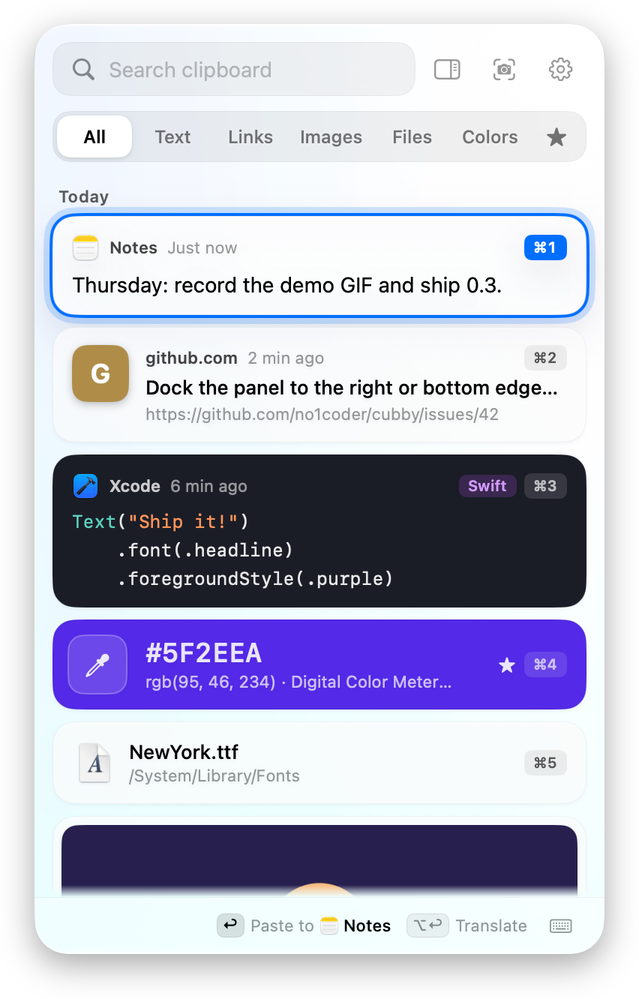
  </picture>
</p>

Cubby lives in your menu bar and remembers what you copy: text, links, code, colors, images and files. Press <kbd>⇧⌘V</kbd>, type a few letters and press <kbd>↩</kbd> to paste into the app you were using, without touching the mouse. It's built for people who copy and paste all day (developers, designers, writers, anyone juggling addresses and snippets) and want a fast tool that respects their privacy. Your history stays on your Mac; Cubby only goes online to check for a new version (once a day, and you can turn that off) or to translate with a language model you set up yourself.

**Highlights**

- **Instant search and paste.** Typed cards for links, code, colors and files, search that also reads text inside images, and paste with <kbd>↩</kbd> or <kbd>⌘1</kbd>–<kbd>⌘9</kbd>.
- **Your layout.** A floating panel, a sidebar docked to the right edge, or a shelf of cards along the bottom; plus an image-only grid on <kbd>⌃⇧V</kbd>.
- **Screenshots and markup.** <kbd>⇧⌘2</kbd> captures a window or area, lets you annotate it, and files it in your history.
- **The clothesline.** Hang up to 12 images at the top of the screen and pull them down from the menu bar whenever you need them.
- **Address guard.** Get warned when malware swaps a crypto address or card number you copied.
- **Translation on macOS 26.** Translate clipboard items and screenshots in place, on-device or with your own model.

## See it in action

<table>
  <tr>
    <td align="center" width="50%">
      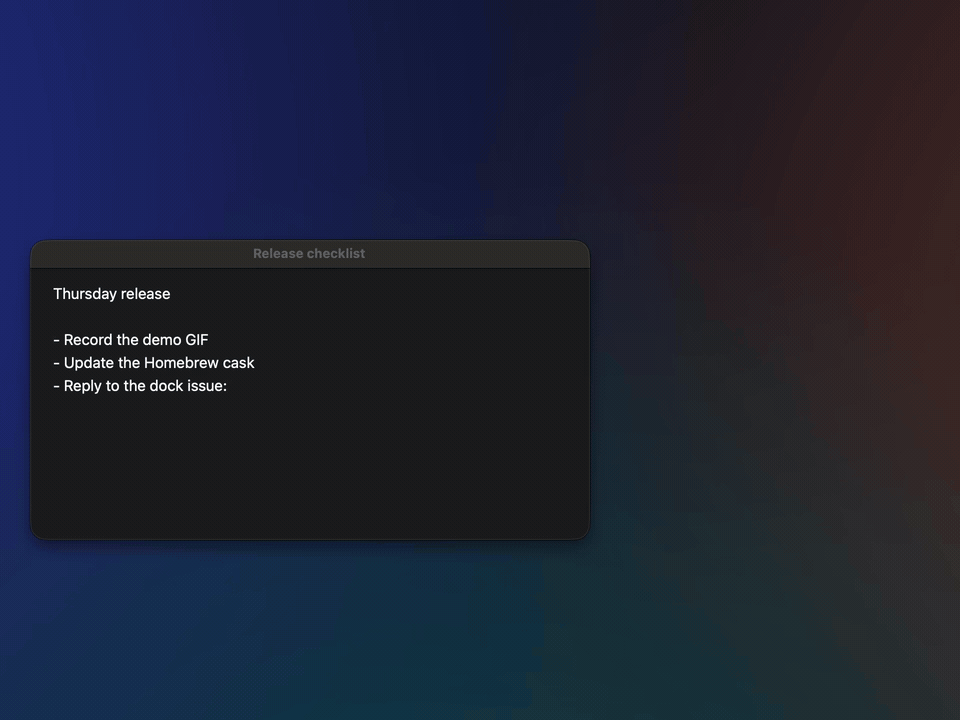<br>
      <sub><b>Search and paste.</b> Type to find, <kbd>↩</kbd> to paste.</sub>
    </td>
    <td align="center" width="50%">
      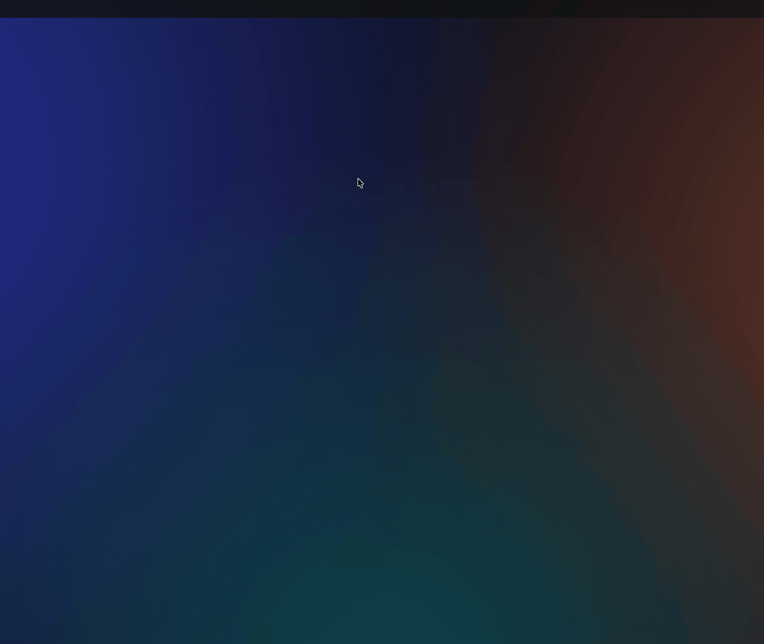<br>
      <sub><b>Clothesline.</b> Drag down from the menu bar to reach your pinned images.</sub>
    </td>
  </tr>
  <tr>
    <td align="center" width="50%">
      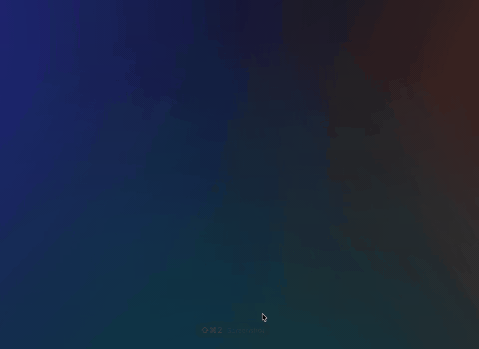<br>
      <sub><b>Screenshot and markup.</b> Capture, annotate, paste.</sub>
    </td>
    <td align="center" width="50%">
      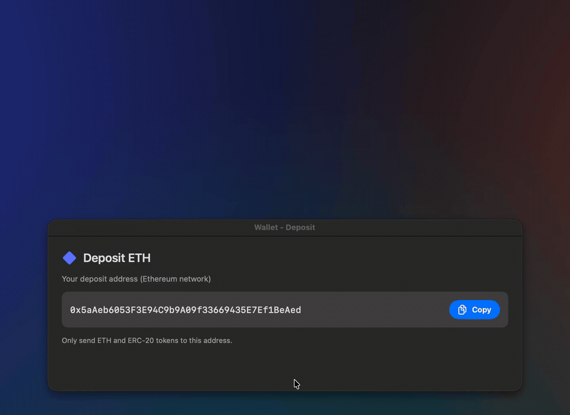<br>
      <sub><b>Address guard.</b> A swapped address is caught before you paste it.</sub>
    </td>
  </tr>
</table>

## Features

**Capture and find**

- Records text (rich text keeps its RTF / HTML formatting), links, HEX colors, images and files. Copying something again moves it back to the top. Favorites never expire; everything else is trimmed to a limit you choose (50 – 2,000 items, 500 by default).
- Cards look like their content: links show the page title and full address, code shows its language with syntax colors, colors show HEX and rgb() values, images show the whole picture. Each card shows the source app, the time and its <kbd>⌘</kbd> number, grouped into Today, Yesterday and Earlier.
- Just start typing to search. Every word must match, matches are highlighted, the best ones come first, and each category shows how many items match. File paths, source apps, link titles and text in images (recognized on your Mac) are searchable too.
- Filter by Text, Links, Images, Files, Colors or Favorites with <kbd>⇥</kbd>. <kbd>Space</kbd> opens a side preview; <kbd>⌘B</kbd> (Pick Words) splits a text into word chips so you paste only the part you need.
- Five panel positions: next to the pointer, under the menu bar icon, centered, docked to the right edge as a full-height sidebar, or docked to the bottom as a shelf of cards. <kbd>⌃⇧V</kbd> opens only your images in a grid. Light, Dark or Match System appearance; Liquid Glass on macOS 26.

**Paste**

- <kbd>↩</kbd> pastes into the app you were using (the footer shows which), <kbd>⇧↩</kbd> pastes in the other format (original ↔ plain text), <kbd>⌘↩</kbd> only copies.
- <kbd>⌘1</kbd> – <kbd>⌘9</kbd> paste one of the first nine items; any card can be dragged into another app.
- Hover over a card to favorite, preview, delete or pin it. <kbd>⌘⌫</kbd> deletes, <kbd>⌘Z</kbd> brings it back.

**Screenshots**

- <kbd>⇧⌘2</kbd> freezes the screen: hover to pick a window (<kbd>⇥</kbd> or scroll steps through overlapping ones), drag out an area, or press <kbd>Space</kbd> for a clean capture of just one window with its shadow.
- Annotate with rectangles, ellipses, arrows, pen, highlighter, mosaic, text and numbered steps, all editable until you finish.
- The result is copied **and saved to your history**. You can also pin it to the screen, save it as a PNG, or extract its text with on-device OCR. A magnifier copies the color under the pointer with <kbd>C</kbd>.

**Clothesline**

- Press <kbd>⌘L</kbd> on an image to hang it on a line at the top of the screen (up to 12). Drag down from an empty spot in the menu bar, rest the pointer at the top edge, press <kbd>⌃⌥T</kbd> or use the menu to slide it down.
- Double-click a photo to copy it, drag it into an app, or click it to enlarge and annotate; **Done & Hang Back** saves the result as a new item and keeps the original. Photos on the line survive history trimming.

**Address guard**

- If a Bitcoin, Ethereum / EVM, TRON, Solana or Litecoin address, or a bank card number, you copied is replaced in the clipboard within seconds while the same app stays in front, a warning compares both values character by character with the differences in red. **Restore What I Copied** puts yours back.
- The replacing item is marked red in your history and can't be pasted, copied or dragged. When you paste an address from Cubby, it checks the clipboard still matches first.
- It never clears your clipboard or intercepts <kbd>⌘V</kbd>. Configure it in Settings › Security.

**Translation** (macOS 26)

- <kbd>⌘T</kbd> translates the selected item in a card beside the panel; <kbd>⌥↩</kbd> translates and pastes in one step; hold <kbd>⌥</kbd> to preview a translation in the list.
- <kbd>⇧⌘T</kbd> in a screenshot translates its text in place, block by block.
- Uses Apple's on-device Translation by default, or any OpenAI-compatible model you set up (DeepSeek, Qwen, Kimi, Zhipu GLM, OpenAI, OpenRouter, a local Ollama or a custom URL). See [Translation](#translation).

**Privacy and polish**

- Local only, excluded from Time Machine, no analytics or telemetry. Skips password-manager content, apps you ignore, and text that looks like an API key, private key or JWT. Pause recording any time. See [Privacy](#privacy).
- Swift 6 with SwiftUI and AppKit, zero third-party dependencies, Universal binary. Menu bar only, no Dock icon. English and Simplified Chinese interface. Works with VoiceOver, Reduce Motion and Increase Contrast.
- A small blue dot on the menu bar icon tells you when a new version is out.

## Design

The v0.3 interface was designed as a set of mockups before it was built. They're shown here with the Chinese UI, and some details changed during implementation; the [user guide](docs/USER-GUIDE.md) describes the shipping app. All mockups are in [docs/design/ui-upgrade](docs/design/ui-upgrade).

<table>
  <tr>
    <td align="center" width="33%">
      <picture>
        <source media="(prefers-color-scheme: light)" srcset="docs/design/ui-upgrade/MainLight.png">
        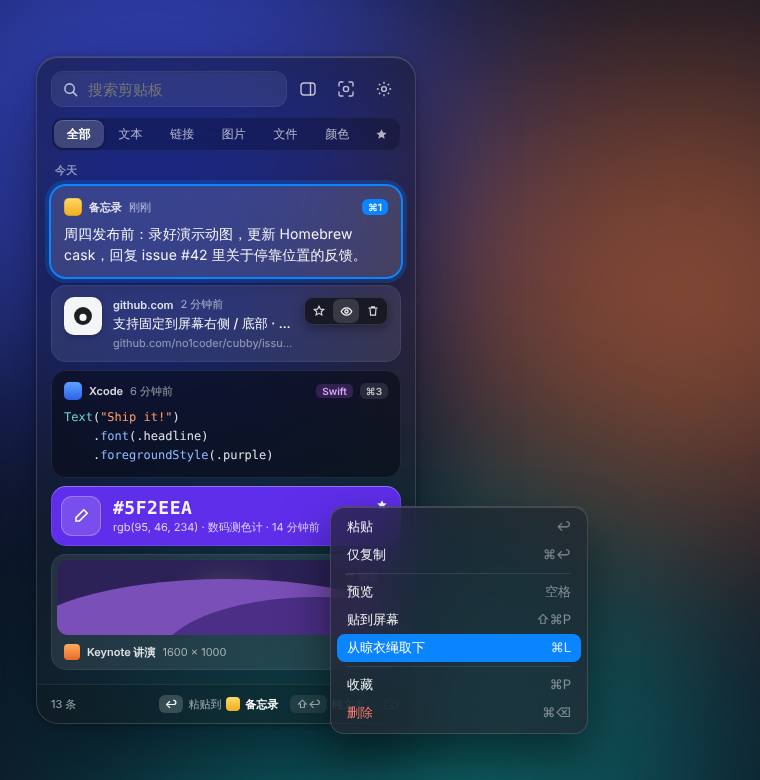
      </picture><br>
      <sub>Floating panel with typed cards</sub>
    </td>
    <td align="center" width="33%">
      <br>
      <sub>Search, no results and empty states</sub>
    </td>
    <td align="center" width="33%">
      <picture>
        <source media="(prefers-color-scheme: light)" srcset="docs/design/ui-upgrade/ImageGridLight.png">
        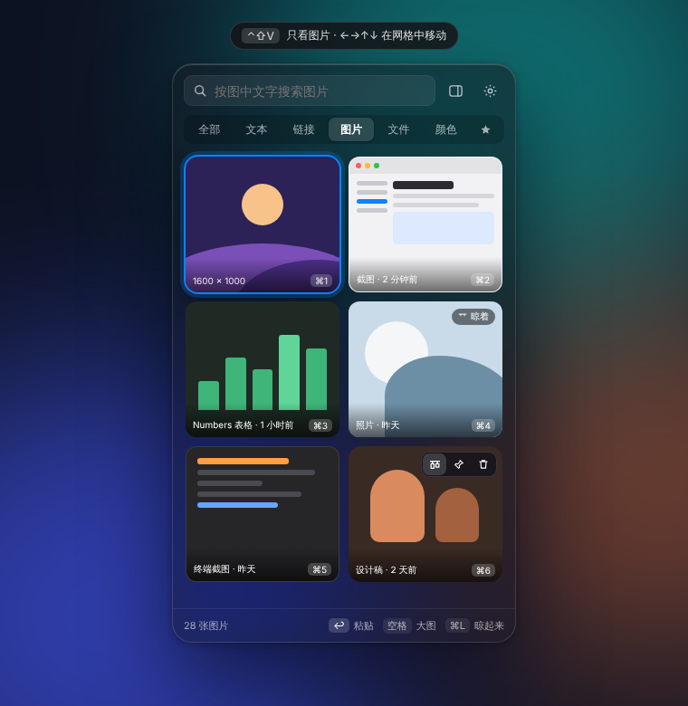
      </picture><br>
      <sub>Only images (<kbd>⌃⇧V</kbd>)</sub>
    </td>
  </tr>
</table>

<table>
  <tr>
    <td align="center" width="50%">
      <picture>
        <source media="(prefers-color-scheme: light)" srcset="docs/design/ui-upgrade/DockRightLight.png">
        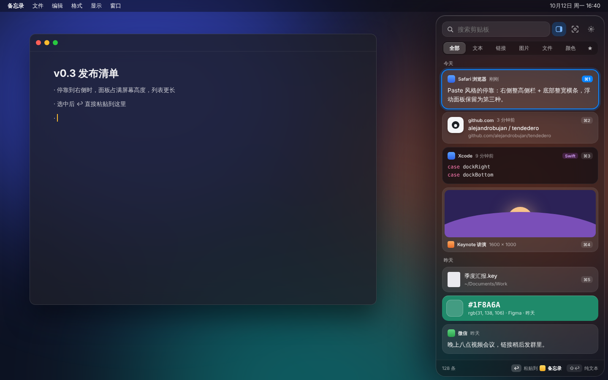
      </picture><br>
      <sub>Docked to the right edge</sub>
    </td>
    <td align="center" width="50%">
      <picture>
        <source media="(prefers-color-scheme: light)" srcset="docs/design/ui-upgrade/DockBottomLight.png">
        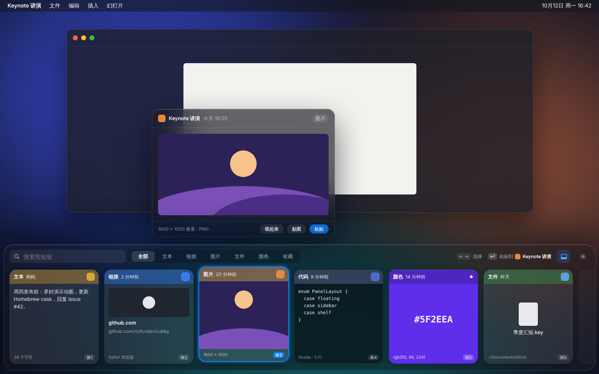
      </picture><br>
      <sub>Docked to the bottom edge</sub>
    </td>
  </tr>
  <tr>
    <td align="center" width="50%">
      <picture>
        <source media="(prefers-color-scheme: light)" srcset="docs/design/ui-upgrade/ClotheslineLight.png">
        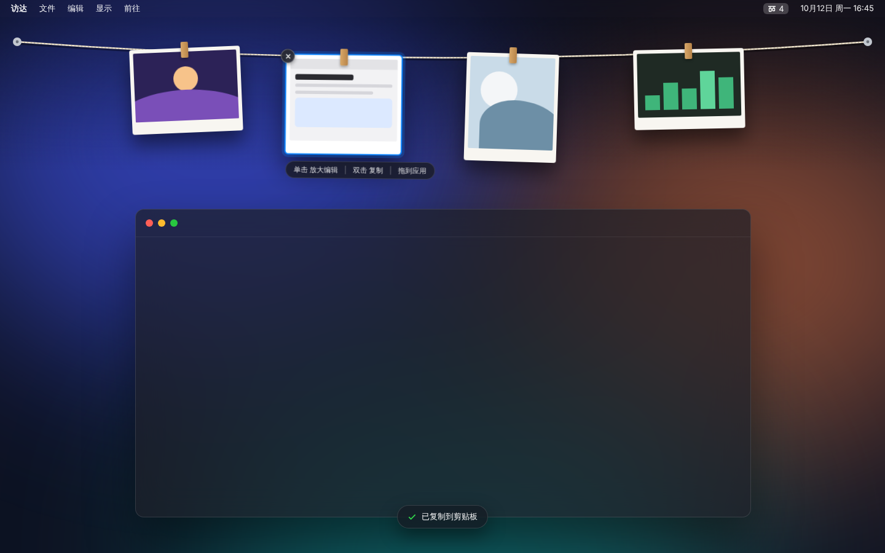
      </picture><br>
      <sub>The clothesline</sub>
    </td>
    <td align="center" width="50%">
      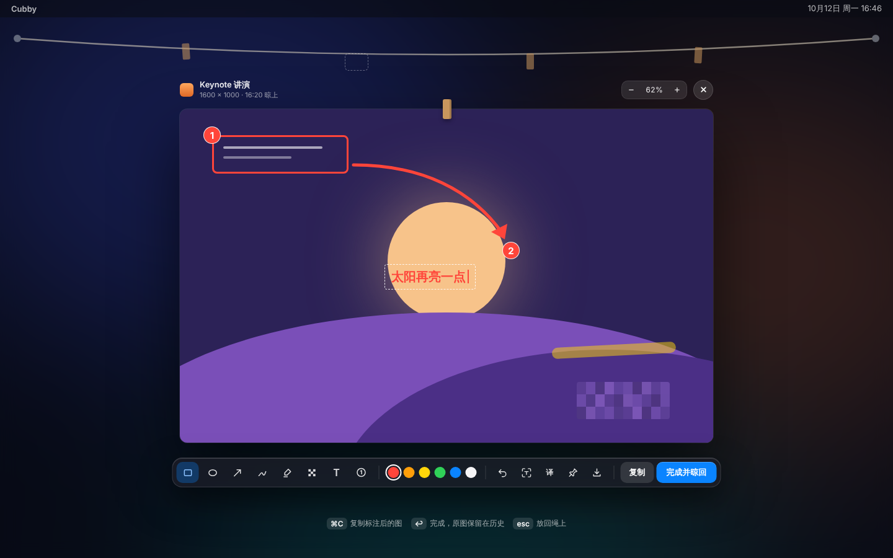<br>
      <sub>Annotating a photo from the line</sub>
    </td>
  </tr>
  <tr>
    <td align="center" width="50%">
      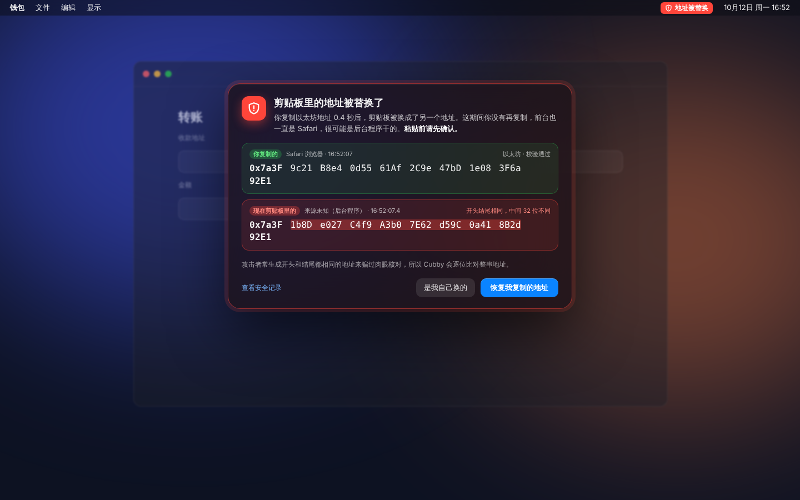<br>
      <sub>Address guard warning</sub>
    </td>
    <td align="center" width="50%">
      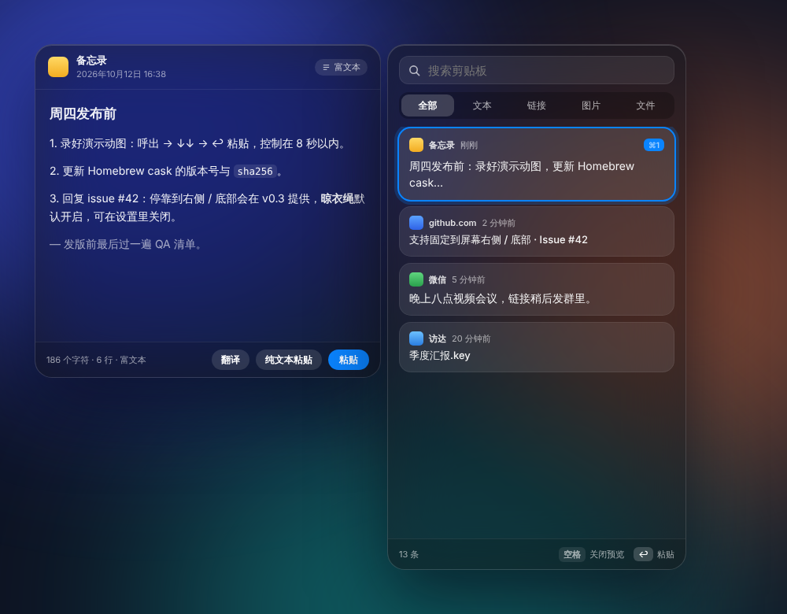<br>
      <sub>Side preview (Space)</sub>
    </td>
  </tr>
</table>

<table>
  <tr>
    <td align="center" width="33%">
      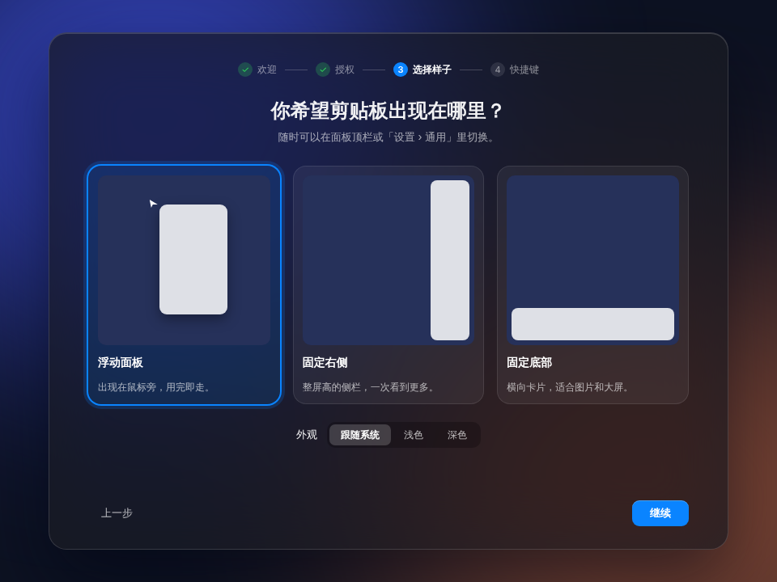<br>
      <sub>Four-step welcome guide</sub>
    </td>
    <td align="center" width="33%">
      <picture>
        <source media="(prefers-color-scheme: light)" srcset="docs/design/ui-upgrade/SettingsLight.png">
        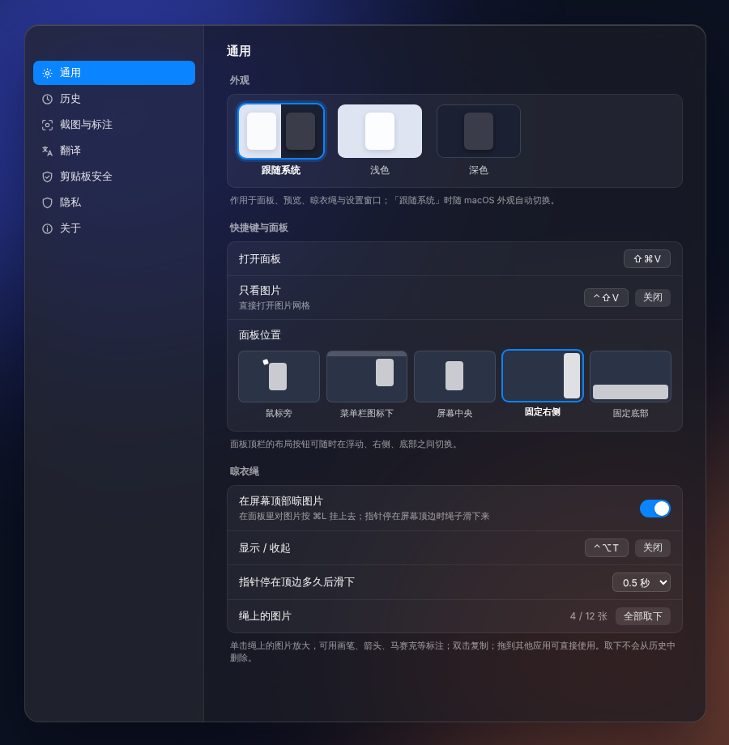
      </picture><br>
      <sub>Settings with a sidebar</sub>
    </td>
    <td align="center" width="33%">
      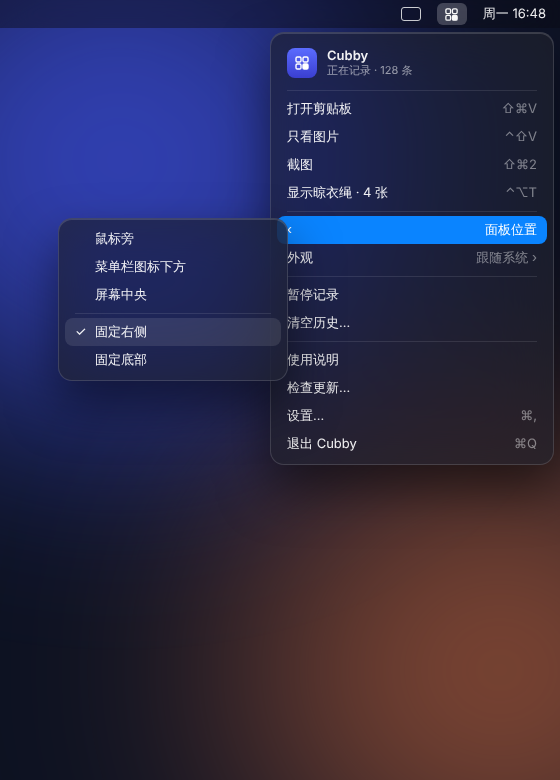<br>
      <sub>Menu bar menu</sub>
    </td>
  </tr>
</table>

## Install

### Homebrew (recommended)

```sh
brew install --cask no1coder/tap/cubby
```

Update with `brew upgrade --cask cubby`.

### Download

1. Download `Cubby-x.y.z.dmg` from the [latest release](https://github.com/no1coder/cubby/releases/latest).
2. Open it and drag **Cubby** into **Applications**.
3. Launch Cubby from Applications (not from the disk image or your Downloads folder).

Releases are signed with a Developer ID and notarized by Apple, so macOS asks for confirmation only once. Each release also includes a `.zip` and `SHA256SUMS.txt`.

### Build from source

```sh
git clone https://github.com/no1coder/cubby.git
cd cubby
make install    # builds a Universal release app, copies it to /Applications and launches it
```

Requires Xcode 26. See [CONTRIBUTING.md](CONTRIBUTING.md) for signing options: with the default ad-hoc signature, macOS forgets the Accessibility and Screen Recording permissions after every rebuild.

## User guide

The [user guide](docs/USER-GUIDE.md) walks through every feature step by step. In the app, choose **User Guide** from the menu bar icon's menu (it's also in Settings › About and at the bottom of the panel's shortcut help).

## First launch and permissions

On first launch a four-step guide (Welcome, Permissions, Choose a Style, Shortcut) asks for two permissions, lets you pick the panel layout and appearance, and sets your shortcuts. Reopen it any time with **Setup Guide…** in the menu bar icon's right-click menu.

**Clipboard access on macOS 15.4 and later.** Click **Grant Access** in the guide (or in Settings › Privacy) and choose **Allow Paste**. If nothing happens, copy something first and click again. The prompt has no "always allow" choice, so also set Cubby to **Allow** in System Settings › Privacy & Security › Paste from Other Apps (called Paste before macOS 26); once macOS has asked, the button changes to **Open System Settings** and takes you there.

| Permission | Why Cubby needs it | Where to grant it |
| --- | --- | --- |
| **Clipboard access** (macOS 15.4 and later) | To read what you copy. Without it macOS keeps asking, or nothing gets recorded. | Click **Grant Access** and choose **Allow Paste**, then System Settings › Privacy & Security › Paste from Other Apps → set Cubby to **Allow** |
| **Accessibility** | To paste by sending <kbd>⌘V</kbd> to the frontmost app. Without it, choosing an item only copies it. | System Settings › Privacy & Security › Accessibility → turn on **Cubby** |
| **Screen Recording** (only for screenshots) | To capture the screen when you take a screenshot. Never used at launch or in the background. Cubby asks the first time you take one. | System Settings › Privacy & Security › Screen & System Audio Recording (Screen Recording on macOS 14) → turn on **Cubby** |
| **Input Monitoring** (optional) | Helps the address guard tell your own <kbd>⌘C</kbd> / <kbd>⌘X</kbd> from a replacement. It only notices those two shortcuts, never what you type. | Settings › Security › **Grant Access**, or System Settings › Privacy & Security › Input Monitoring |

After you turn on Screen Recording, macOS may ask you to quit and reopen Cubby; the **Quit & Reopen Cubby** button in Cubby's Screen Recording window does both.

Click the menu bar icon to open the panel. Right-click (or Control-click) it for its status, Only Images, Take Screenshot, Show Clothesline, Panel Position, Appearance, Pause Recording, Clear History, User Guide, Setup Guide, Check for Updates, Settings and Quit.

## Keyboard shortcuts

| Key | Action |
| --- | --- |
| <kbd>⇧⌘V</kbd> | Open or close the panel (global, customizable) |
| <kbd>⌃⇧V</kbd> | Open the panel on your images only (global, customizable or off) |
| <kbd>⌃⌥T</kbd> | Show or hide the clothesline (global, customizable or off) |
| <kbd>⇧⌘2</kbd> | Take a screenshot (global, customizable or off) |
| Type anything | Search |
| <kbd>↑</kbd> <kbd>↓</kbd> (<kbd>←</kbd> <kbd>→</kbd> in the image grid and bottom shelf) | Move the selection |
| <kbd>↩</kbd> or double-click | Paste into the current app |
| <kbd>⇧↩</kbd> / <kbd>⌘↩</kbd> | Paste in the other format / copy only |
| <kbd>⌘1</kbd> – <kbd>⌘9</kbd> | Paste item 1 – 9 |
| <kbd>Space</kbd> / <kbd>⌘Y</kbd> | Toggle the preview (<kbd>Space</kbd> only while the search field is empty) |
| <kbd>⇥</kbd> / <kbd>⇧⇥</kbd> | Next / previous category |
| <kbd>⌘B</kbd> | Pick Words |
| <kbd>⌘P</kbd> | Favorite / unfavorite |
| <kbd>⇧⌘P</kbd> | Pin the selected image to the screen |
| <kbd>⌘L</kbd> | Hang the selected image on the clothesline, or take it down |
| <kbd>⌘T</kbd> / <kbd>⌥↩</kbd> / hold <kbd>⌥</kbd> | Translate / translate and paste / preview the translation (macOS 26) |
| <kbd>⌘⌫</kbd> / <kbd>⌘Z</kbd> | Delete / undo delete |
| <kbd>⌘O</kbd> | Open the link or file |
| <kbd>⌘,</kbd> | Settings |
| <kbd>esc</kbd> | Step back: close help or preview → clear search → close the panel |

<details>
<summary><b>Screenshot shortcuts</b></summary>
<br>

| Key | Action |
| --- | --- |
| Click / drag | Select the highlighted window or screen / select an area |
| <kbd>⇥</kbd> / <kbd>⇧⇥</kbd> or scroll | Step through overlapping windows under the pointer, down to the whole screen |
| <kbd>Space</kbd> | Window mode: capture only the highlighted window, unobstructed, with its shadow (<kbd>⌥</kbd>-click leaves out the shadow) |
| Hold <kbd>⇧</kbd> / <kbd>⌥</kbd> / <kbd>Space</kbd> while dragging | Square selection / grow from the center / move the selection |
| <kbd>⌘A</kbd> | Select the whole screen |
| <kbd>↑</kbd> <kbd>↓</kbd> <kbd>←</kbd> <kbd>→</kbd> | Move the selection or the selected annotation by 1 pt (10 pt with <kbd>⇧</kbd>) |
| <kbd>R</kbd> <kbd>O</kbd> <kbd>A</kbd> <kbd>P</kbd> <kbd>H</kbd> <kbd>M</kbd> <kbd>T</kbd> <kbd>N</kbd> | Rectangle, ellipse, arrow, pen, highlighter, mosaic, text, number (same key or <kbd>V</kbd> returns to the pointer) |
| <kbd>⌫</kbd> | Delete the selected annotation |
| <kbd>⌘Z</kbd> / <kbd>⇧⌘Z</kbd> | Undo / redo annotations |
| <kbd>C</kbd> | Copy the color under the magnifier (hold <kbd>⇧</kbd> for RGB) |
| <kbd>↩</kbd>, <kbd>⌘C</kbd> or double-click | Done: copy to the clipboard and history |
| <kbd>⌘S</kbd> | Save as a PNG |
| <kbd>⌘P</kbd> | Pin to the screen |
| <kbd>⌘T</kbd> | Extract text and copy it |
| <kbd>⇧⌘T</kbd> | Translate the text in the selection (macOS 26) |
| Right-click | Clear the selection and select again; with no selection, cancel |
| <kbd>esc</kbd> | Cancel (press twice once you've drawn something) |

</details>

The keyboard button in the panel footer shows the shortcut list inside the app, and right-clicking a card lists its actions. The [user guide](docs/USER-GUIDE.md#shortcut-reference) has the complete reference, including the clothesline, the translation card and pinned images.

## Translation

On macOS 26, select an item in the panel and press <kbd>⌘T</kbd>: a translation card opens beside the panel and fills in paragraph by paragraph, keeping headings, lists, bold text and links. In a screenshot, <kbd>⇧⌘T</kbd> draws each translation where the original text was; hold <kbd>Space</kbd> to peek at the original or drag the divider to compare.

| Translate a screenshot in place | Translate a clipboard item |
| :---: | :---: |
| 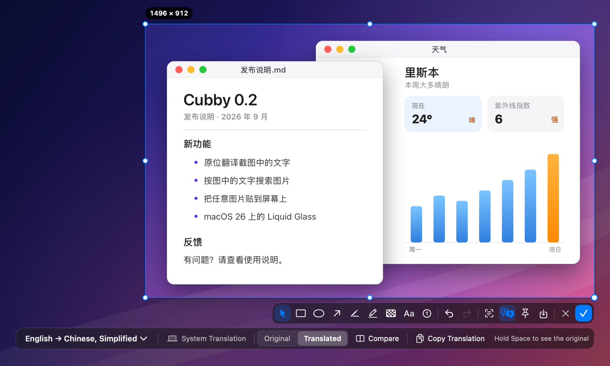 | 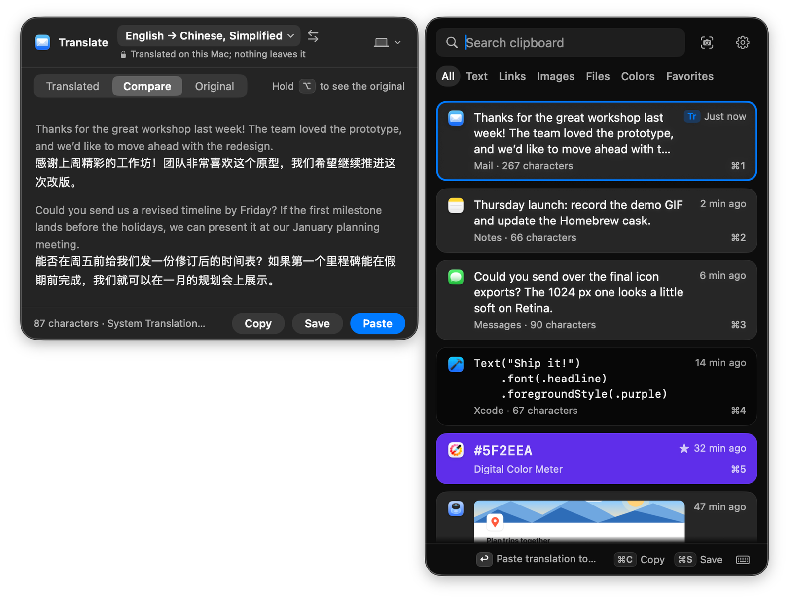 |

Choose the engine in **Settings › Translation**:

- **System Translation** (default): Apple's built-in Translation, on your Mac and offline. macOS asks before downloading a language pack.
- **Large language model**: any OpenAI-compatible Chat Completions service. Presets for DeepSeek, Qwen (Alibaba Cloud Model Studio), Kimi (Moonshot AI), Zhipu GLM (and Z.ai), OpenAI, OpenRouter and Ollama on your Mac, or a custom base URL.

Your API key is stored in the macOS login Keychain, never in preferences, history or logs. With a model, only the text you translate is sent (for an image or screenshot, the text recognized in it); the image itself is never uploaded, text under mosaic is never sent, and text that looks like a secret is sent only after you confirm (never from an image). Remote services must use HTTPS; plain HTTP is only allowed for `localhost`.

## Privacy

- **Local only.** History lives in `~/Library/Application Support/Cubby`: the folder is readable only by you (0700), files are 0600, and it's excluded from Time Machine.
- **Skips sensitive content.** Items marked concealed or transient (as password managers do), apps in your Ignored Apps list (Settings › Privacy), and, unless you turn it off, text that looks like an API key, private key or JWT.
- **Pastes where you expect.** Cubby checks that the target app is still frontmost before sending <kbd>⌘V</kbd>, and that an address it's about to paste is still the one in your clipboard.
- **Address guard stays local.** With Input Monitoring it only notices <kbd>⌘C</kbd> and <kbd>⌘X</kbd>, never what you type, and its security log stays on your Mac with shortened values only.
- **Screenshots and image text stay on your Mac.** The screen is captured only when you take a screenshot, and canceling leaves nothing behind. Text in images is recognized on your Mac with Apple's Vision framework and kept only in your history file.
- **Online only for updates and the translation service you set up.** The update check (once a day, on by default, off in Settings › General) only reads the latest version number from `api.github.com/repos/no1coder/cubby/releases/latest` and uploads nothing. A language model you configure receives only the text you translate.
- **No analytics, no telemetry, no crash reporting.**

Full details in [PRIVACY.md](PRIVACY.md).

## FAQ

<details>
<summary><b>Accessibility is switched on, but Cubby only copies instead of pasting.</b></summary>

macOS ties the permission to the app's code signature. After an update, or after installing a build signed differently (for example a source build and then a release), the switch can still look on while no longer applying. Open System Settings › Privacy & Security › Accessibility, select **Cubby**, click **−** to remove it, then add it again or relaunch Cubby and grant access. Alternatively, run:

```sh
tccutil reset Accessibility io.github.no1coder.Cubby
```

Then open Cubby and grant access again.

</details>

<details>
<summary><b>macOS says Cubby can't be opened or can't be verified.</b></summary>

Official releases are notarized, so you should see a single "downloaded from the Internet" confirmation and nothing else. Make sure you downloaded Cubby from this repository's Releases page or installed it with Homebrew, and that you launch it from Applications. You can check the signature with:

```sh
spctl -a -vvv /Applications/Cubby.app    # expect: source=Notarized Developer ID
```

If the check fails, delete the app, download it again and [open an issue](https://github.com/no1coder/cubby/issues/new/choose) if the problem persists. There is no need to disable Gatekeeper.

</details>

<details>
<summary><b>Cubby warned me that an address was replaced. What should I do?</b></summary>

The clipboard changed to another address or card number of the same kind right after you copied one, while the same app stayed in front. Compare the two values in the warning. If you didn't make the change, click **Restore What I Copied** and check your Mac for software you don't recognize; if you did (for example, you quickly copied a second address in the same app), click **I Changed It Myself**. Allowing Input Monitoring in Settings › Security helps Cubby tell your own copies apart.

</details>

<details>
<summary><b>Where is my data stored?</b></summary>

- History: `~/Library/Application Support/Cubby` (`history.json` plus an `Images` folder)
- Preferences: `~/Library/Preferences/io.github.no1coder.Cubby.plist`
- Saved screenshots: wherever you choose in the save dialog, or, with **Ask where to save each time** turned off, the folder in Settings › Screenshots (by default, the same folder as macOS screenshots)

Settings › History can reveal the folder in Finder. See [PRIVACY.md](PRIVACY.md) for exactly what is stored.

</details>

<details>
<summary><b>Can I export or back up my history?</b></summary>

Not yet; import and export are on the [roadmap](docs/ROADMAP.md). The data folder is excluded from Time Machine on purpose, because clipboards often contain sensitive content. Until export ships, you can quit Cubby and copy `~/Library/Application Support/Cubby` manually. Keep in mind that the copy contains everything you have copied, unencrypted.

</details>

<details>
<summary><b>How do I uninstall Cubby?</b></summary>

With Homebrew, this removes the app and all of its data:

```sh
brew uninstall --zap --cask cubby
```

Otherwise, quit Cubby and run:

```sh
rm -rf /Applications/Cubby.app ~/Library/Application\ Support/Cubby
defaults delete io.github.no1coder.Cubby
tccutil reset All io.github.no1coder.Cubby
```

</details>

## Contributing

Bug reports, translations and pull requests are welcome. [CONTRIBUTING.md](CONTRIBUTING.md) covers building from source, tests, code style and local signing. Please read the [Code of Conduct](CODE_OF_CONDUCT.md), and report security issues privately as described in [SECURITY.md](SECURITY.md).

## Roadmap

v0.3 brought docked layouts, the image grid, the clothesline, the address guard, Pick Words and a redesigned panel, settings and welcome guide. Still planned: automatic cleanup by age, multi-select and merged paste, a paste queue, text transforms, editing before pasting, Quick Look and import / export; for screenshots, selecting UI elements by holding <kbd>⌥</kbd> and restoring the last selection. See [docs/ROADMAP.md](docs/ROADMAP.md) for details and [CHANGELOG.md](CHANGELOG.md) for release notes.

## License

[MIT](LICENSE) © 2026 no1coder
