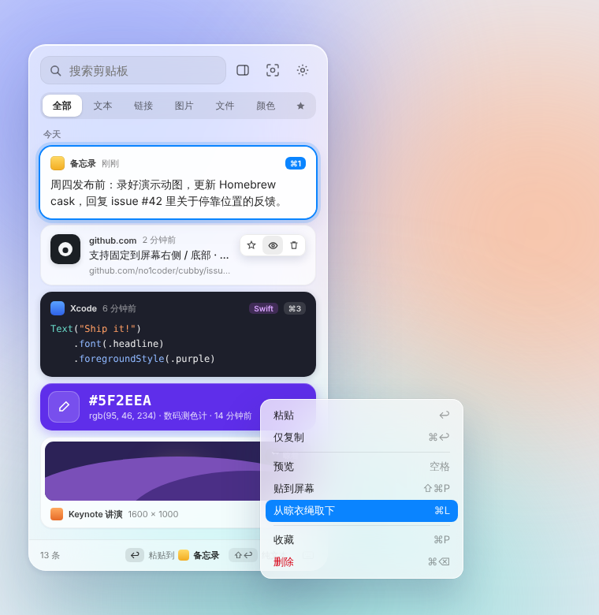
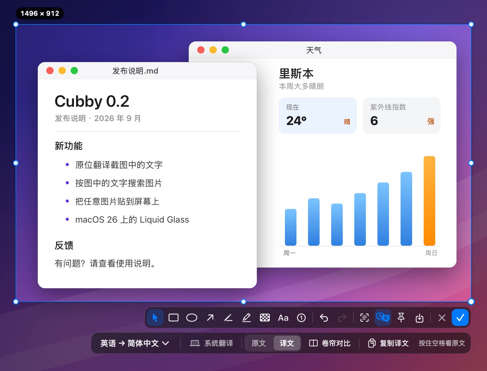
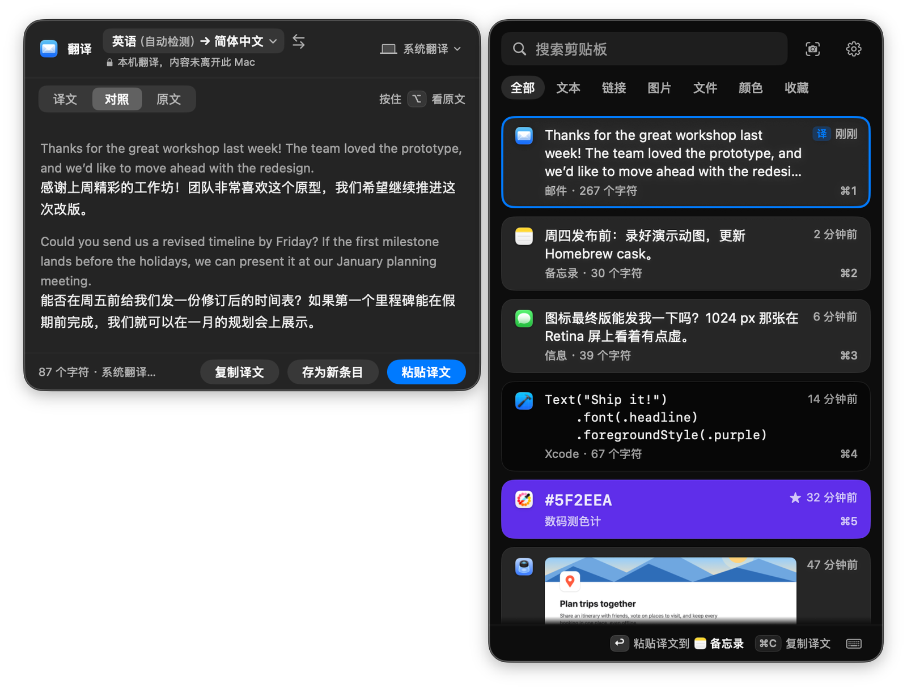

<p align="center">
  
</p>

<h1 align="center">Cubby · 小格子</h1>

<p align="center">
  <b>复制过的一切，按一下就回来。</b><br>
  原生、键盘优先、数据从不离开本机的 macOS 剪贴板工具。
</p>

<p align="center">
  <a href="LICENSE"></a>
  
  
</p>

<p align="center">
  <a href="README.md">English</a> · <b>简体中文</b> · <a href="README.zh-Hant.md">繁體中文</a> · <a href="README.ja.md">日本語</a> · <a href="README.es.md">Español</a> · <a href="README.de.md">Deutsch</a> · <a href="README.fr.md">Français</a>
</p>

```sh
brew install --cask no1coder/tap/cubby
```

也可以从 [Releases](https://github.com/no1coder/cubby/releases/latest) 下载已公证的 DMG。需要 macOS 14 及以上，支持 Apple 芯片与 Intel。

<p align="center">
  <picture>
    <source media="(prefers-color-scheme: dark)" srcset="docs/design/ui-upgrade/Main.png">
    <source media="(prefers-color-scheme: light)" srcset="docs/design/ui-upgrade/MainLight.png">
    
  </picture>
</p>

Cubby 常驻菜单栏，记住你复制过的文本、链接、代码、颜色、图片和文件。按 <kbd>⇧⌘V</kbd>，输入几个字，按 <kbd>↩</kbd> 就能粘贴到刚才使用的应用，全程不用碰鼠标。它为整天复制粘贴的人而做：开发者、设计师、写作者，以及经常要倒腾地址和片段的每个人，既要快，也要放心。历史只保存在你的 Mac 上；Cubby 只在两种情况下联网：检查新版本（每天一次，可以关闭），以及使用你自己配置的大模型翻译。

**亮点**

- **秒搜秒贴。** 链接、代码、颜色、文件各有专属卡片，连图片里的文字都能搜到；按 <kbd>↩</kbd> 或 <kbd>⌘1</kbd>–<kbd>⌘9</kbd> 直接粘贴。
- **随你摆放。** 浮动面板、固定在右侧的整屏高侧栏，或固定在底部的横向卡片条；<kbd>⌃⇧V</kbd> 还能只看图片网格。
- **截图与标注。** <kbd>⇧⌘2</kbd> 截取窗口或区域，标注完自动存进历史。
- **晾衣绳。** 把最多 12 张图片晾在屏幕顶部，需要时从菜单栏往下一拉就到。
- **地址守护。** 你复制的加密货币地址或银行卡号被恶意软件偷换时，立刻提醒你。
- **macOS 26 上的翻译。** 原位翻译剪贴板条目和截图，用本机翻译或你自己的大模型。

## 动图演示

<table>
  <tr>
    <td align="center" width="50%">
      <br>
      <sub><b>搜索与粘贴。</b>输入即搜，<kbd>↩</kbd> 即贴。</sub>
    </td>
    <td align="center" width="50%">
      <br>
      <sub><b>晾衣绳。</b>从菜单栏往下拖，晾着的图片就在手边。</sub>
    </td>
  </tr>
  <tr>
    <td align="center" width="50%">
      <br>
      <sub><b>截图与标注。</b>截图、标注、粘贴，一气呵成。</sub>
    </td>
    <td align="center" width="50%">
      <br>
      <sub><b>地址守护。</b>地址被偷换，粘贴前就拦下。</sub>
    </td>
  </tr>
</table>

## 功能

**记录与查找**

- 记录文本（富文本保留 RTF / HTML 格式）、链接、HEX 颜色、图片和文件。再次复制相同内容时移到最前。收藏永不过期；其余条目按你设定的上限保留（50 – 2000 条，默认 500）。
- 卡片按内容呈现：链接显示页面标题和完整地址，代码显示语言并带语法高亮，颜色显示 HEX 与 rgb() 值，图片完整显示整张图。每张卡片顶部有来源应用、时间和 <kbd>⌘</kbd> 序号，列表按「今天」「昨天」「更早」分组。
- 直接输入即可搜索：多个关键词需全部命中，命中处高亮，最相关的排在最前，每个分类显示命中条数。文件路径、来源应用、链接标题和图片中的文字（在本机识别）也都能搜到。
- 用 <kbd>⇥</kbd> 在文本、链接、图片、文件、颜色、收藏之间切换分类。<kbd>空格</kbd> 打开侧边预览；<kbd>⌘B</kbd>（拆词）把一段文字拆成词块，只粘贴你需要的那部分。
- 面板有五种位置：鼠标旁、菜单栏图标下方、屏幕中央、固定在右侧成为整屏高侧栏，或固定在底部成为横向卡片条。<kbd>⌃⇧V</kbd> 以网格只看图片。外观可选跟随系统、浅色或深色；macOS 26 上为 Liquid Glass 效果。

**粘贴**

- <kbd>↩</kbd> 粘贴到刚才使用的应用（底栏会显示是哪个），<kbd>⇧↩</kbd> 以另一种格式粘贴（保留原格式 ↔ 纯文本），<kbd>⌘↩</kbd> 仅复制。
- <kbd>⌘1</kbd> – <kbd>⌘9</kbd> 快速粘贴前九条；卡片可直接拖到其他应用。
- 鼠标悬停在卡片上即可收藏、预览、删除或贴图。<kbd>⌘⌫</kbd> 删除，<kbd>⌘Z</kbd> 撤销删除。

**截图**

- <kbd>⇧⌘2</kbd> 冻结屏幕画面：悬停即识别窗口（窗口重叠时用 <kbd>⇥</kbd> 或滚轮逐层切换），拖拽框选区域，或按 <kbd>空格</kbd> 只截这一个窗口，不受遮挡，带阴影。
- 标注工具：矩形、椭圆、箭头、画笔、荧光笔、马赛克、文字、序号；完成前始终可编辑。
- 截好的图复制到剪贴板，**同时存入历史**。还可以贴到屏幕上、存为 PNG，或用本机 OCR 提取文字。放大镜下按 <kbd>C</kbd> 复制光标处的颜色。

**晾衣绳**

- 在图片上按 <kbd>⌘L</kbd>，把它晾到屏幕顶部的绳子上（最多 12 张）。从菜单栏空白处往下拖、指针停在屏幕顶边、按 <kbd>⌃⌥T</kbd> 或从菜单打开，绳子就会滑下来。
- 双击照片复制，拖进应用直接使用，单击放大并标注；「完成并晾回」把结果存为新条目，原图保留。绳上的照片不会因历史超出上限而被清理。

**地址守护**

- 你复制的比特币、以太坊 / EVM 链、波场 TRON、Solana、莱特币地址或银行卡号，如果在几秒内、前台应用没变的情况下被换成另一个，Cubby 会弹出警示，逐个字符对比两个值并用红色标出差异。「恢复我复制的地址」一键换回。
- 替换进来的值在历史中标为红色，不能粘贴、复制或拖出。从 Cubby 粘贴地址前，还会先核对剪贴板是否一致。
- 它从不清除剪贴板，也不拦截 <kbd>⌘V</kbd>。在「设置 › 剪贴板安全」中配置。

**翻译**（macOS 26）

- <kbd>⌘T</kbd> 在面板旁的翻译卡中翻译选中的条目；<kbd>⌥↩</kbd> 一步翻译并粘贴；按住 <kbd>⌥</kbd> 在列表中预览译文。
- 截图时按 <kbd>⇧⌘T</kbd>，逐块原位翻译图中文字。
- 默认使用 Apple 本机翻译，也可以接入你配置的任何兼容 OpenAI 接口的大模型（DeepSeek、通义千问、Kimi、智谱 GLM、OpenAI、OpenRouter、本机 Ollama 或自定义地址）。详见 [翻译](#翻译)。

**隐私与细节**

- 只存本机，排除在 Time Machine 之外，无统计、无遥测。不记录密码管理器的内容、你忽略的应用，以及疑似 API Key、私钥、JWT 的文本。可随时暂停记录。详见 [隐私](#隐私)。
- Swift 6 + SwiftUI / AppKit，零第三方依赖，Universal 二进制。只在菜单栏，不占 Dock。界面支持英文与简体中文。支持 VoiceOver，并遵循「减弱动态效果」与「增强对比度」。
- 有新版本时，菜单栏图标会出现一个小蓝点。

## 设计稿

v0.3 的界面先画设计稿再动手实现。下面的设计稿使用中文界面，部分细节在实现时有所调整，实际行为以 [使用说明](docs/USER-GUIDE.zh-Hans.md) 为准。全部设计稿见 [docs/design/ui-upgrade](docs/design/ui-upgrade)。

<table>
  <tr>
    <td align="center" width="33%">
      <picture>
        <source media="(prefers-color-scheme: light)" srcset="docs/design/ui-upgrade/MainLight.png">
        
      </picture><br>
      <sub>浮动面板与各类卡片</sub>
    </td>
    <td align="center" width="33%">
      <br>
      <sub>搜索、无结果与空状态</sub>
    </td>
    <td align="center" width="33%">
      <picture>
        <source media="(prefers-color-scheme: light)" srcset="docs/design/ui-upgrade/ImageGridLight.png">
        
      </picture><br>
      <sub>只看图片（<kbd>⌃⇧V</kbd>）</sub>
    </td>
  </tr>
</table>

<table>
  <tr>
    <td align="center" width="50%">
      <picture>
        <source media="(prefers-color-scheme: light)" srcset="docs/design/ui-upgrade/DockRightLight.png">
        
      </picture><br>
      <sub>固定右侧</sub>
    </td>
    <td align="center" width="50%">
      <picture>
        <source media="(prefers-color-scheme: light)" srcset="docs/design/ui-upgrade/DockBottomLight.png">
        
      </picture><br>
      <sub>固定底部</sub>
    </td>
  </tr>
  <tr>
    <td align="center" width="50%">
      <picture>
        <source media="(prefers-color-scheme: light)" srcset="docs/design/ui-upgrade/ClotheslineLight.png">
        
      </picture><br>
      <sub>晾衣绳</sub>
    </td>
    <td align="center" width="50%">
      <br>
      <sub>放大绳上的照片并标注</sub>
    </td>
  </tr>
  <tr>
    <td align="center" width="50%">
      <br>
      <sub>地址被替换警示</sub>
    </td>
    <td align="center" width="50%">
      <br>
      <sub>侧边预览（空格）</sub>
    </td>
  </tr>
</table>

<table>
  <tr>
    <td align="center" width="33%">
      <br>
      <sub>四步欢迎引导</sub>
    </td>
    <td align="center" width="33%">
      <picture>
        <source media="(prefers-color-scheme: light)" srcset="docs/design/ui-upgrade/SettingsLight.png">
        
      </picture><br>
      <sub>侧边栏式设置</sub>
    </td>
    <td align="center" width="33%">
      <br>
      <sub>菜单栏菜单</sub>
    </td>
  </tr>
</table>

## 安装

### Homebrew（推荐）

```sh
brew install --cask no1coder/tap/cubby
```

升级：`brew upgrade --cask cubby`。

### 下载安装包

1. 从 [最新 Release](https://github.com/no1coder/cubby/releases/latest) 下载 `Cubby-x.y.z.dmg`。
2. 打开后把 **Cubby** 拖进「应用程序」。
3. 从「应用程序」中启动（不要直接在磁盘映像或「下载」文件夹里运行）。

发布版使用 Developer ID 签名并经过 Apple 公证，首次打开只会出现一次确认。每个 Release 另附 `.zip` 与 `SHA256SUMS.txt`。

### 从源码构建

```sh
git clone https://github.com/no1coder/cubby.git
cd cubby
make install    # 构建 Universal Release 版，复制到 /Applications 并启动
```

需要 Xcode 26。签名方式见 [CONTRIBUTING.md](CONTRIBUTING.md)：使用默认的 ad-hoc 签名时，每次重新构建后 macOS 都会使辅助功能和屏幕录制授权失效。

## 使用说明

[使用说明](docs/USER-GUIDE.zh-Hans.md)按步骤介绍了每一项功能。在应用里，从菜单栏图标的菜单选择「使用说明」即可打开（「设置 › 关于」和面板快捷键帮助的底部也有入口）。

## 首次启动与权限

首次启动会打开四步引导（欢迎、授权、选择样子、快捷键）：授予两项权限，选择面板的布局和外观，并设置快捷键。之后可随时从菜单栏图标的右键菜单「设置向导…」重新打开。

**macOS 15.4 及以上的剪贴板读取权限。** 在引导窗口（或「设置 › 隐私」）中点「去授权」，选择「允许粘贴」。如果没有弹出，先随便复制一点内容再点一次。系统询问框没有「始终允许」选项，因此还需要在「系统设置 › 隐私与安全性 › 从其他 App 粘贴」（macOS 26 之前为「粘贴」）中将 Cubby 设为「允许」；系统询问过之后，按钮会变为「打开系统设置」，点击即可直达。

| 权限 | 用途 | 开启位置 |
| --- | --- | --- |
| **剪贴板读取**（macOS 15.4 及以上） | 读取你复制的内容。未允许时系统会反复询问，或无法记录。 | 点「去授权」并选择「允许粘贴」，再到系统设置 › 隐私与安全性 › 从其他 App 粘贴 → 将 Cubby 设为 **允许** |
| **辅助功能** | 向当前应用发送 <kbd>⌘V</kbd> 以直接粘贴。未授权时选中条目只会复制。 | 系统设置 › 隐私与安全性 › 辅助功能 → 打开 **Cubby** |
| **屏幕录制**（仅截图时需要） | 截图时捕捉屏幕画面。启动时和后台从不使用；第一次截图时才会申请。 | 系统设置 › 隐私与安全性 › 录屏与系统录音（macOS 14 为「屏幕录制」）→ 打开 **Cubby** |
| **输入监控**（可选） | 帮地址守护分清你自己按的 <kbd>⌘C</kbd> / <kbd>⌘X</kbd> 和替换。只识别这两个快捷键，不记录任何按键内容。 | 设置 › 剪贴板安全 › 「去授权」，或系统设置 › 隐私与安全性 › 输入监控 |

开启屏幕录制后，macOS 可能要求退出并重新打开 Cubby；Cubby 屏幕录制引导窗口中的「退出并重新打开 Cubby」按钮可以一步完成。

左键点击菜单栏图标打开面板；右键（或按住 Control 点按）打开菜单：状态、只看图片、截图、显示晾衣绳、面板位置、外观、暂停记录、清空历史、使用说明、设置向导、检查更新、设置、退出。

## 快捷键

| 按键 | 作用 |
| --- | --- |
| <kbd>⇧⌘V</kbd> | 打开 / 关闭面板（全局，可修改） |
| <kbd>⌃⇧V</kbd> | 打开面板并只看图片（全局，可修改或关闭） |
| <kbd>⌃⌥T</kbd> | 显示 / 收起晾衣绳（全局，可修改或关闭） |
| <kbd>⇧⌘2</kbd> | 截图（全局，可修改或关闭） |
| 直接输入 | 搜索 |
| <kbd>↑</kbd> <kbd>↓</kbd>（图片网格和底部卡片条中为 <kbd>←</kbd> <kbd>→</kbd>） | 移动选择 |
| <kbd>↩</kbd> 或双击 | 粘贴到当前应用 |
| <kbd>⇧↩</kbd> / <kbd>⌘↩</kbd> | 以另一种格式粘贴 / 仅复制 |
| <kbd>⌘1</kbd> – <kbd>⌘9</kbd> | 粘贴第 1 – 9 条 |
| <kbd>空格</kbd> / <kbd>⌘Y</kbd> | 打开 / 关闭预览（<kbd>空格</kbd> 仅在搜索框为空时有效） |
| <kbd>⇥</kbd> / <kbd>⇧⇥</kbd> | 下一个 / 上一个分类 |
| <kbd>⌘B</kbd> | 拆词 |
| <kbd>⌘P</kbd> | 收藏 / 取消收藏 |
| <kbd>⇧⌘P</kbd> | 把选中的图片贴到屏幕上 |
| <kbd>⌘L</kbd> | 把选中的图片晾到晾衣绳上，或从绳上取下 |
| <kbd>⌘T</kbd> / <kbd>⌥↩</kbd> / 按住 <kbd>⌥</kbd> | 翻译 / 翻译并粘贴 / 预览译文（macOS 26） |
| <kbd>⌘⌫</kbd> / <kbd>⌘Z</kbd> | 删除 / 撤销删除 |
| <kbd>⌘O</kbd> | 打开链接或文件 |
| <kbd>⌘,</kbd> | 设置 |
| <kbd>esc</kbd> | 逐级后退：关闭帮助或预览 → 清空搜索 → 关闭面板 |

<details>
<summary><b>截图快捷键</b></summary>
<br>

| 按键 | 作用 |
| --- | --- |
| 单击 / 拖拽 | 选中高亮的窗口或整屏 / 框选区域 |
| <kbd>⇥</kbd> / <kbd>⇧⇥</kbd> 或滚轮 | 在光标下重叠的窗口间逐层切换，最深一层为整屏 |
| <kbd>空格</kbd> | 纯净窗口截图模式：只截高亮的窗口，不受遮挡，带阴影（按住 <kbd>⌥</kbd> 单击则不带阴影） |
| 拖拽时按住 <kbd>⇧</kbd> / <kbd>⌥</kbd> / <kbd>空格</kbd> | 正方形选区 / 从中心扩展 / 平移选区 |
| <kbd>⌘A</kbd> | 选中整屏 |
| <kbd>↑</kbd> <kbd>↓</kbd> <kbd>←</kbd> <kbd>→</kbd> | 移动选区或选中的标注 1 pt（按住 <kbd>⇧</kbd> 为 10 pt） |
| <kbd>R</kbd> <kbd>O</kbd> <kbd>A</kbd> <kbd>P</kbd> <kbd>H</kbd> <kbd>M</kbd> <kbd>T</kbd> <kbd>N</kbd> | 矩形、椭圆、箭头、画笔、荧光笔、马赛克、文字、序号（再按同一个键或按 <kbd>V</kbd> 回到指针） |
| <kbd>⌫</kbd> | 删除选中的标注 |
| <kbd>⌘Z</kbd> / <kbd>⇧⌘Z</kbd> | 撤销 / 重做标注 |
| <kbd>C</kbd> | 复制放大镜下的颜色（按住 <kbd>⇧</kbd> 显示 RGB） |
| <kbd>↩</kbd>、<kbd>⌘C</kbd> 或双击 | 完成：复制到剪贴板并存入历史 |
| <kbd>⌘S</kbd> | 存为 PNG |
| <kbd>⌘P</kbd> | 贴图（贴到屏幕上） |
| <kbd>⌘T</kbd> | 提取文字并复制 |
| <kbd>⇧⌘T</kbd> | 翻译选区中的文字（macOS 26） |
| 右键 | 清除选区后重新框选；没有选区时取消 |
| <kbd>esc</kbd> | 取消（画过标注后需按两次） |

</details>

面板底栏的键盘按钮可以在应用内查看快捷键，右键卡片会列出它的全部操作。完整列表（含晾衣绳、翻译卡与贴图）见 [使用说明](docs/USER-GUIDE.zh-Hans.md#快捷键速查)。

## 翻译

macOS 26 上，在面板中选中条目按 <kbd>⌘T</kbd>：面板旁会打开翻译卡并逐段填入译文，保留标题、列表、粗体和链接。截图时按 <kbd>⇧⌘T</kbd>，译文会画在原文所在的位置；按住 <kbd>空格</kbd> 查看原文，或拖动分隔线卷帘对比。

| 原位翻译截图 | 翻译剪贴板条目 |
| :---: | :---: |
|  |  |

在「设置 › 翻译」中选择引擎：

- **系统翻译**（默认）：macOS 自带的翻译，在本机完成，可离线使用。下载语言包前 macOS 会先询问你。
- **大模型**：任何兼容 OpenAI Chat Completions 接口的服务。预设：DeepSeek、通义千问（阿里云百炼）、Kimi（月之暗面）、智谱 GLM（及国际版 Z.ai）、OpenAI、OpenRouter、本机 Ollama，也可以填写自定义地址。

API Key 存在 macOS 登录钥匙串中，不会写入偏好设置、历史或日志。使用大模型时只发送你要翻译的文字（图片和截图只发送其中识别出的文字）；图片本身不会上传，被马赛克遮住的文字不会发送，疑似密钥的文字需你确认后才发送（来自图片的则从不发送）。远程服务必须使用 HTTPS，只有 `localhost` 可以用 HTTP。

## 隐私

- **只存本机。** 历史保存在 `~/Library/Application Support/Cubby`：目录权限 0700（仅本人可访问）、文件 0600，并排除在 Time Machine 之外。
- **跳过敏感内容。** 不记录标记为机密 / 临时的内容（密码管理器会这样标记）、「忽略的应用」列表中的应用（设置 › 隐私），以及（除非你关闭该选项）疑似 API Key、私钥、JWT 的文本。
- **粘贴不跑偏。** 发送 <kbd>⌘V</kbd> 前校验目标应用仍在前台；粘贴地址前还会确认剪贴板里仍是这个地址。
- **地址守护只在本机。** 开启输入监控后也只识别 <kbd>⌘C</kbd> 和 <kbd>⌘X</kbd>，从不记录你输入的内容；安全记录只保存在本机，且只存缩写后的值。
- **截图与图中文字只在本机。** 只有你主动截图时才会捕捉屏幕，取消截图不留任何痕迹。图片中的文字用 Apple Vision 框架在本机识别，只保存在本地历史文件中。
- **只为更新检查和你配置的翻译服务联网。** 更新检查（每天一次，默认开启，可在「设置 › 通用」中关闭）只从 `api.github.com/repos/no1coder/cubby/releases/latest` 读取最新版本号，不上传任何数据；你配置的大模型只会收到你要翻译的文字。
- **无统计、无遥测、无崩溃上报。**

完整说明见 [PRIVACY.md](PRIVACY.md)。

## 常见问题

<details>
<summary><b>辅助功能开关显示已开启，但 Cubby 只复制不粘贴。</b></summary>

macOS 把该权限与应用的代码签名绑定。更新后，或安装了签名不同的版本（例如先装源码构建版、再装发布版），开关可能仍显示开启，实际已失效。打开「系统设置 › 隐私与安全性 › 辅助功能」，选中 **Cubby**，点 **−** 删除，再重新添加或重新打开 Cubby 授权。也可以在终端执行：

```sh
tccutil reset Accessibility io.github.no1coder.Cubby
```

然后打开 Cubby 重新授权。

</details>

<details>
<summary><b>macOS 提示无法打开 Cubby 或无法验证开发者。</b></summary>

正式发布版已经过公证，正常情况下只会出现一次「从互联网下载」的确认。请确认是从本仓库的 Releases 页面下载或通过 Homebrew 安装，并从「应用程序」中启动。可以这样检查签名：

```sh
spctl -a -vvv /Applications/Cubby.app    # 期望输出：source=Notarized Developer ID
```

若检查未通过，请删除后重新下载；问题仍在时欢迎 [提交 Issue](https://github.com/no1coder/cubby/issues/new/choose)。无需关闭 Gatekeeper。

</details>

<details>
<summary><b>Cubby 提示地址被替换了，该怎么办？</b></summary>

你刚复制一个地址或银行卡号，剪贴板就变成了另一个同类型的值，而前台应用一直没变。请对比警示卡中的两个值：如果不是你换的，点「恢复我复制的地址」，并检查 Mac 上有没有你不认识的软件；如果是你自己换的（例如在同一个应用里很快地复制了第二个地址），点「是我自己换的」。在「设置 › 剪贴板安全」中允许输入监控后，Cubby 能更准确地分清你自己的复制。

</details>

<details>
<summary><b>数据存在哪里？</b></summary>

- 历史：`~/Library/Application Support/Cubby`（`history.json` 与 `Images` 文件夹）
- 偏好设置：`~/Library/Preferences/io.github.no1coder.Cubby.plist`
- 存储的截图：存储对话框中选择的位置；关闭「每次存储前询问位置」时为「设置 › 截图」中的文件夹（默认与系统截图相同）

「设置 › 历史」中可以在访达中显示数据目录。具体存储内容见 [PRIVACY.md](PRIVACY.md)。

</details>

<details>
<summary><b>能导出或备份历史吗？</b></summary>

暂不支持，导入导出已列入 [路线图](docs/ROADMAP.md)。数据目录有意排除在 Time Machine 之外，因为剪贴板常含敏感内容。在此之前，可以先退出 Cubby，再手动复制 `~/Library/Application Support/Cubby`。请注意副本中包含你复制过的全部内容，且未加密。

</details>

<details>
<summary><b>如何卸载？</b></summary>

通过 Homebrew 安装的，以下命令会删除应用及全部数据：

```sh
brew uninstall --zap --cask cubby
```

其他情况请先退出 Cubby，然后执行：

```sh
rm -rf /Applications/Cubby.app ~/Library/Application\ Support/Cubby
defaults delete io.github.no1coder.Cubby
tccutil reset All io.github.no1coder.Cubby
```

</details>

## 参与贡献

欢迎提交问题、翻译与 Pull Request。源码构建、测试、代码风格与本地签名见 [CONTRIBUTING.md](CONTRIBUTING.md)（英文）。请阅读 [行为准则](CODE_OF_CONDUCT.md)；安全问题请按 [SECURITY.md](SECURITY.md) 私下报告。

## 路线图

v0.3 带来了固定右侧 / 底部布局、图片网格、晾衣绳、地址守护、拆词，以及重新设计的面板、设置和欢迎引导。后续计划：按时间自动清理、多选合并粘贴、粘贴队列、文本转换、编辑后粘贴、Quick Look、导入导出；截图方面，按住 <kbd>⌥</kbd> 识别界面元素、恢复上次选区。详见 [docs/ROADMAP.md](docs/ROADMAP.md)，版本变化见 [CHANGELOG.md](CHANGELOG.md)。

## 许可证

[MIT](LICENSE) © 2026 no1coder
