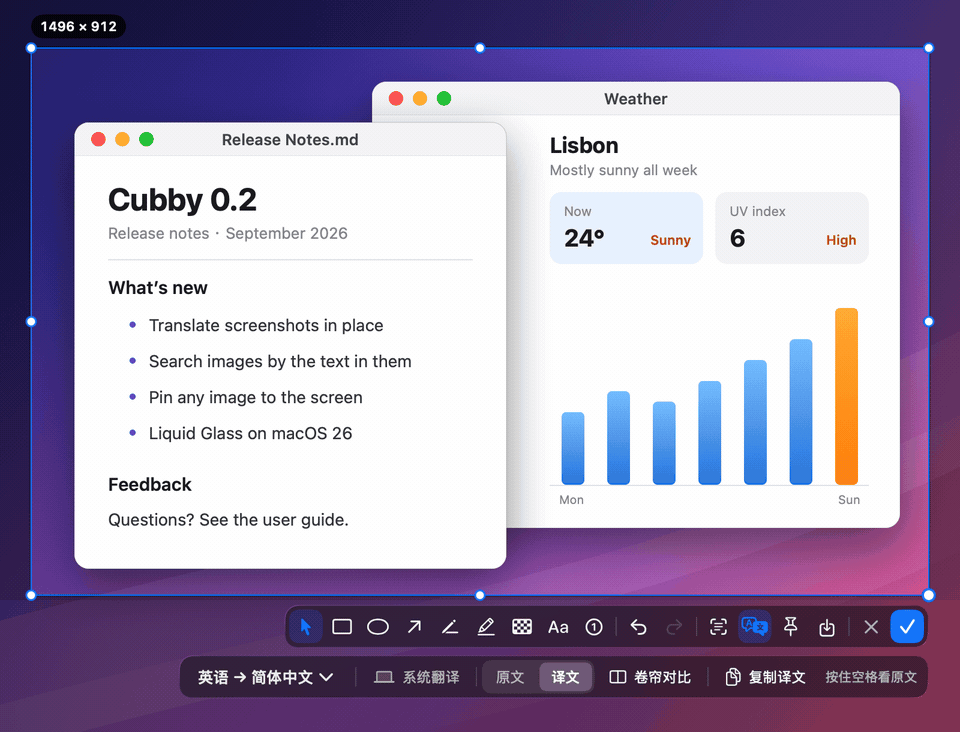

<p align="center">
  
</p>

<h1 align="center">Cubby · 小格子</h1>

<p align="center">
  <b>複製過的一切，按一下就回來。</b><br>
  原生、鍵盤優先、資料從不離開本機的 macOS 剪貼簿工具。
</p>

<p align="center">
  <a href="LICENSE"></a>
  
  
</p>

<p align="center">
  <a href="README.md">English</a> · <a href="README.zh-Hans.md">简体中文</a> · <b>繁體中文</b> · <a href="README.ja.md">日本語</a> · <a href="README.es.md">Español</a> · <a href="README.de.md">Deutsch</a> · <a href="README.fr.md">Français</a>
</p>

```sh
brew install --cask no1coder/tap/cubby
```

也可以從 [Releases](https://github.com/no1coder/cubby/releases/latest) 下載已經過公證的 DMG。需要 macOS 14 以上版本，支援 Apple 晶片與 Intel。

<p align="center">
  <picture>
    <source media="(prefers-color-scheme: dark)" srcset="docs/design/ui-upgrade/Main.png">
    <source media="(prefers-color-scheme: light)" srcset="docs/design/ui-upgrade/MainLight.png">
    
  </picture>
</p>

Cubby 常駐在選單列，記住你複製過的文字、連結、程式碼、顏色、圖片和檔案。按下 <kbd>⇧⌘V</kbd>，輸入幾個字，再按 <kbd>↩</kbd>，就能貼到剛才使用的 App，全程不必碰滑鼠。它是為整天複製貼上的人打造的：開發者、設計師、文字工作者，以及常常要搬弄地址和片段的每個人，既要快，也要安心。歷史記錄只保存在你的 Mac 上；Cubby 只在兩種情況下連網：檢查新版本（每天一次，可以關閉），以及使用你自己設定的大型語言模型翻譯。

**亮點**

- **秒搜秒貼。** 連結、程式碼、顏色、檔案各有專屬卡片，連圖片裡的文字都搜得到；按 <kbd>↩</kbd> 或 <kbd>⌘1</kbd>–<kbd>⌘9</kbd> 直接貼上。
- **隨你擺放。** 浮動面板、固定在右側的整個螢幕高側邊欄，或固定在底部的橫向卡片列；按 <kbd>⌃⇧V</kbd> 還能只看圖片網格。
- **截圖與標註。** <kbd>⇧⌘2</kbd> 擷取視窗或區域，標註完自動存進歷史記錄。
- **曬衣繩。** 把最多 12 張圖片晾在螢幕頂端，需要時從選單列往下一拉就到。
- **地址守護。** 你複製的加密貨幣地址或卡號被惡意軟體偷換時，立刻提醒你。
- **macOS 26 上的翻譯。** 就地翻譯剪貼簿項目和截圖，可用裝置端翻譯或你自己的模型。

## 動畫示範

<table>
  <tr>
    <td align="center" width="50%">
      <br>
      <sub><b>搜尋與貼上。</b>輸入即搜，<kbd>↩</kbd> 即貼。</sub>
    </td>
    <td align="center" width="50%">
      <br>
      <sub><b>曬衣繩。</b>從選單列往下拖，晾著的圖片就在手邊。</sub>
    </td>
  </tr>
  <tr>
    <td align="center" width="50%">
      <br>
      <sub><b>截圖與標註。</b>擷取、標註、貼上，一氣呵成。</sub>
    </td>
    <td align="center" width="50%">
      <br>
      <sub><b>地址守護。</b>地址被偷換，貼上前就攔下。</sub>
    </td>
  </tr>
  <tr>
    <td align="center" colspan="2">
      <br>
      <sub><b>截圖翻譯（macOS 26）。</b> 按 <kbd>⇧⌘T</kbd>，譯文直接蓋在原文位置，排版不亂；拖動捲簾對照原文。</sub>
    </td>
  </tr>
</table>

## 功能

**記錄與搜尋**

- 記錄文字（格式化文字保留 RTF / HTML 格式）、連結、HEX 顏色、圖片和檔案。再次複製相同內容時會移到最前面。收藏永不過期；其餘項目依你設定的上限保留（50 – 2,000 筆，預設 500）。
- 卡片依內容呈現：連結顯示網頁標題和完整網址，程式碼顯示語言並附語法上色，顏色顯示 HEX 與 rgb() 值，圖片完整顯示整張圖。每張卡片都會標出來源 App、時間和 <kbd>⌘</kbd> 編號，列表依「今天」「昨天」「更早」分組。
- 直接輸入就能搜尋：多個關鍵字須全部符合，符合處會反白標示，最相關的排在最前面，每個分類也會顯示符合的筆數。檔案路徑、來源 App、連結標題和圖片中的文字（在本機辨識）同樣搜得到。
- 用 <kbd>⇥</kbd> 在文字、連結、圖片、檔案、顏色、收藏之間切換分類。<kbd>空白鍵</kbd> 開啟側邊預覽；<kbd>⌘B</kbd>（拆詞）把一段文字拆成詞塊，只貼上你需要的部分。
- 面板有五種位置：滑鼠指標旁、選單列圖示下方、螢幕中央、固定在右側成為整個螢幕高的側邊欄，或固定在底部成為橫向卡片列。<kbd>⌃⇧V</kbd> 以網格只看圖片。外觀可選跟隨系統、淺色或深色；macOS 26 上為 Liquid Glass 效果。

**貼上**

- <kbd>↩</kbd> 貼到剛才使用的 App（底列會顯示是哪一個），<kbd>⇧↩</kbd> 以另一種格式貼上（保留原格式 ↔ 純文字），<kbd>⌘↩</kbd> 只複製。
- <kbd>⌘1</kbd> – <kbd>⌘9</kbd> 快速貼上前九筆；任何卡片都能直接拖到其他 App。
- 滑鼠停在卡片上即可收藏、預覽、刪除或釘到螢幕上。<kbd>⌘⌫</kbd> 刪除，<kbd>⌘Z</kbd> 復原刪除。

**截圖**

- <kbd>⇧⌘2</kbd> 凍結螢幕畫面：指標停留即可選取視窗（視窗重疊時用 <kbd>⇥</kbd> 或捲動逐層切換），拖曳框選區域，或按 <kbd>空白鍵</kbd> 只擷取這一個視窗，不受遮擋，附帶陰影。
- 標註工具：矩形、橢圓、箭頭、畫筆、螢光筆、馬賽克、文字、編號；完成前都能再編輯。
- 擷取的圖會複製到剪貼簿，**同時存入歷史記錄**。也可以釘到螢幕上、存成 PNG，或用裝置端 OCR 擷取文字。放大鏡下按 <kbd>C</kbd> 可複製指標處的顏色。

**曬衣繩**

- 在圖片上按 <kbd>⌘L</kbd>，把它晾到螢幕頂端的繩子上（最多 12 張）。從選單列空白處往下拖、把指標停在螢幕頂端、按 <kbd>⌃⌥T</kbd> 或從選單開啟，繩子就會滑下來。
- 按兩下照片即可複製，拖進 App 直接使用，按一下放大並標註；「完成並晾回」會把結果存成新項目，原圖保留。繩上的照片不會因歷史記錄超過上限而被清掉。

**地址守護**

- 你複製的比特幣、以太坊 / EVM 鏈、波場 TRON、Solana、萊特幣地址或銀行卡號，若在幾秒內、前景 App 沒變的情況下被換成另一個，Cubby 會跳出警示，逐字比對兩個值並以紅色標出差異。按「恢復我複製的地址」就能一鍵換回。
- 替換進來的值在歷史記錄中會標成紅色，無法貼上、複製或拖出。從 Cubby 貼上地址前，也會先確認剪貼簿內容是否一致。
- 它從不清除剪貼簿，也不攔截 <kbd>⌘V</kbd>。可在「設定 › 剪貼簿安全」中調整。

**翻譯**（macOS 26）

- <kbd>⌘T</kbd> 在面板旁的翻譯卡中翻譯選取的項目；<kbd>⌥↩</kbd> 一步完成翻譯並貼上；按住 <kbd>⌥</kbd> 可在列表中預覽譯文。
- 截圖時按 <kbd>⇧⌘T</kbd>，逐塊就地翻譯圖中文字。
- 預設使用 Apple 裝置端翻譯，也可以接上任何你設定好、相容 OpenAI 介面的模型（DeepSeek、通義千問、Kimi、智譜 GLM、OpenAI、OpenRouter、本機 Ollama 或自訂網址）。詳見[翻譯](#翻譯)。

**隱私與細節**

- 只存在本機，排除在 Time Machine 之外，沒有統計、沒有遙測。不記錄密碼管理工具的內容、你忽略的 App，以及疑似 API Key、私鑰、JWT 的文字。可隨時暫停記錄。詳見[隱私](#隱私)。
- Swift 6 + SwiftUI / AppKit，零第三方相依套件，Universal 二進位檔。只在選單列，不佔 Dock。介面支援英文與簡體中文。支援 VoiceOver，並遵循「減少動態效果」與「增加對比」。
- 有新版本時，選單列圖示上會出現一個小藍點。

## 設計稿

v0.3 的介面是先畫設計稿再動手實作的。以下設計稿採用中文介面，部分細節在實作時有所調整，實際行為以[使用說明](docs/USER-GUIDE.md)（英文）為準。所有設計稿請見 [docs/design/ui-upgrade](docs/design/ui-upgrade)。

<table>
  <tr>
    <td align="center" width="33%">
      <picture>
        <source media="(prefers-color-scheme: light)" srcset="docs/design/ui-upgrade/MainLight.png">
        
      </picture><br>
      <sub>浮動面板與各類卡片</sub>
    </td>
    <td align="center" width="33%">
      <br>
      <sub>搜尋、無結果與空白狀態</sub>
    </td>
    <td align="center" width="33%">
      <picture>
        <source media="(prefers-color-scheme: light)" srcset="docs/design/ui-upgrade/ImageGridLight.png">
        
      </picture><br>
      <sub>只看圖片（<kbd>⌃⇧V</kbd>）</sub>
    </td>
  </tr>
</table>

<table>
  <tr>
    <td align="center" width="50%">
      <picture>
        <source media="(prefers-color-scheme: light)" srcset="docs/design/ui-upgrade/DockRightLight.png">
        
      </picture><br>
      <sub>固定在右側</sub>
    </td>
    <td align="center" width="50%">
      <picture>
        <source media="(prefers-color-scheme: light)" srcset="docs/design/ui-upgrade/DockBottomLight.png">
        
      </picture><br>
      <sub>固定在底部</sub>
    </td>
  </tr>
  <tr>
    <td align="center" width="50%">
      <picture>
        <source media="(prefers-color-scheme: light)" srcset="docs/design/ui-upgrade/ClotheslineLight.png">
        
      </picture><br>
      <sub>曬衣繩</sub>
    </td>
    <td align="center" width="50%">
      <br>
      <sub>放大繩上的照片並標註</sub>
    </td>
  </tr>
  <tr>
    <td align="center" width="50%">
      <br>
      <sub>地址遭替換警示</sub>
    </td>
    <td align="center" width="50%">
      <br>
      <sub>側邊預覽（空白鍵）</sub>
    </td>
  </tr>
</table>

<table>
  <tr>
    <td align="center" width="33%">
      <br>
      <sub>四步驟歡迎導覽</sub>
    </td>
    <td align="center" width="33%">
      <picture>
        <source media="(prefers-color-scheme: light)" srcset="docs/design/ui-upgrade/SettingsLight.png">
        
      </picture><br>
      <sub>側邊欄式設定</sub>
    </td>
    <td align="center" width="33%">
      <br>
      <sub>選單列選單</sub>
    </td>
  </tr>
</table>

## 安裝

### Homebrew（建議）

```sh
brew install --cask no1coder/tap/cubby
```

更新：`brew upgrade --cask cubby`。

### 下載安裝檔

1. 從[最新 Release](https://github.com/no1coder/cubby/releases/latest) 下載 `Cubby-x.y.z.dmg`。
2. 打開後把 **Cubby** 拖進「應用程式」。
3. 從「應用程式」啟動（不要直接在磁碟映像檔或「下載項目」資料夾裡執行）。

正式版以 Developer ID 簽署並經 Apple 公證，第一次開啟時只會出現一次確認。每個 Release 另附 `.zip` 與 `SHA256SUMS.txt`。

### 從原始碼建置

```sh
git clone https://github.com/no1coder/cubby.git
cd cubby
make install    # builds a Universal release app, copies it to /Applications and launches it
```

需要 Xcode 26。簽署方式請見 [CONTRIBUTING.md](CONTRIBUTING.md)：使用預設的 ad-hoc 簽署時，每次重新建置後 macOS 都會讓輔助使用和螢幕錄製的授權失效。

## 使用說明

[使用說明](docs/USER-GUIDE.md)（英文）逐步介紹每一項功能。在 App 中，從選單列圖示的選單選擇「使用說明」即可開啟（「設定 › 關於」和面板快速鍵說明的底部也有入口）。

## 首次啟動與權限

第一次啟動時會開啟四步驟導覽（歡迎、授權、選擇樣式、快速鍵）：授予兩項權限，選擇面板的版面和外觀，並設定快速鍵。之後隨時可以從選單列圖示的右鍵選單「設定嚮導…」重新開啟。

**macOS 15.4 以上版本的剪貼簿讀取權限。** 在導覽視窗（或「設定 › 隱私」）中按「去授權」，再選擇「允許貼上」。如果沒有跳出提示，先隨便複製一點內容再按一次。系統詢問視窗沒有「永遠允許」選項，所以還要到「系統設定 › 隱私權與安全性 › 從其他 App 貼上」（macOS 26 之前為「貼上」）將 Cubby 設為「允許」；系統詢問過之後，按鈕會變成「打開系統設定」，按下即可直達。

| 權限 | 用途 | 開啟位置 |
| --- | --- | --- |
| **剪貼簿讀取**（macOS 15.4 以上） | 讀取你複製的內容。未允許時系統會一再詢問，或根本無法記錄。 | 按「去授權」並選擇「允許貼上」，再到系統設定 › 隱私權與安全性 › 從其他 App 貼上 → 將 Cubby 設為 **允許** |
| **輔助使用** | 向目前的 App 傳送 <kbd>⌘V</kbd> 以直接貼上。未授權時，選取項目只會複製。 | 系統設定 › 隱私權與安全性 › 輔助使用 → 開啟 **Cubby** |
| **螢幕錄製**（僅截圖需要） | 截圖時擷取螢幕畫面。啟動時和背景中從不使用；第一次截圖時才會要求。 | 系統設定 › 隱私權與安全性 › 螢幕與系統錄音（macOS 14 為「螢幕錄製」）→ 開啟 **Cubby** |
| **輸入監控**（選用） | 幫助地址守護分辨你自己按的 <kbd>⌘C</kbd> / <kbd>⌘X</kbd> 與替換。只辨識這兩個快速鍵，不記錄任何按鍵內容。 | 設定 › 剪貼簿安全 › 「去授權」，或系統設定 › 隱私權與安全性 › 輸入監控 |

開啟螢幕錄製後，macOS 可能會要求結束並重新開啟 Cubby；Cubby 螢幕錄製導覽視窗中的「結束並重新開啟 Cubby」按鈕可以一次完成。

按一下選單列圖示開啟面板；按右鍵（或按住 Control 再按一下）開啟選單：狀態、只看圖片、截圖、顯示曬衣繩、面板位置、外觀、暫停記錄、清除歷史記錄、使用說明、設定嚮導、檢查更新、設定、結束。

## 快速鍵

| 按鍵 | 作用 |
| --- | --- |
| <kbd>⇧⌘V</kbd> | 開啟 / 關閉面板（全域，可自訂） |
| <kbd>⌃⇧V</kbd> | 開啟面板並只看圖片（全域，可自訂或關閉） |
| <kbd>⌃⌥T</kbd> | 顯示 / 收起曬衣繩（全域，可自訂或關閉） |
| <kbd>⇧⌘2</kbd> | 截圖（全域，可自訂或關閉） |
| 直接輸入 | 搜尋 |
| <kbd>↑</kbd> <kbd>↓</kbd>（圖片網格和底部卡片列中為 <kbd>←</kbd> <kbd>→</kbd>） | 移動選取 |
| <kbd>↩</kbd> 或按兩下 | 貼到目前的 App |
| <kbd>⇧↩</kbd> / <kbd>⌘↩</kbd> | 以另一種格式貼上 / 只複製 |
| <kbd>⌘1</kbd> – <kbd>⌘9</kbd> | 貼上第 1 – 9 筆 |
| <kbd>空白鍵</kbd> / <kbd>⌘Y</kbd> | 開啟 / 關閉預覽（<kbd>空白鍵</kbd> 僅在搜尋框為空時有效） |
| <kbd>⇥</kbd> / <kbd>⇧⇥</kbd> | 下一個 / 上一個分類 |
| <kbd>⌘B</kbd> | 拆詞 |
| <kbd>⌘P</kbd> | 收藏 / 取消收藏 |
| <kbd>⇧⌘P</kbd> | 把選取的圖片釘到螢幕上 |
| <kbd>⌘L</kbd> | 把選取的圖片晾到曬衣繩上，或從繩上取下 |
| <kbd>⌘T</kbd> / <kbd>⌥↩</kbd> / 按住 <kbd>⌥</kbd> | 翻譯 / 翻譯並貼上 / 預覽譯文（macOS 26） |
| <kbd>⌘⌫</kbd> / <kbd>⌘Z</kbd> | 刪除 / 復原刪除 |
| <kbd>⌘O</kbd> | 開啟連結或檔案 |
| <kbd>⌘,</kbd> | 設定 |
| <kbd>esc</kbd> | 逐層返回：關閉說明或預覽 → 清除搜尋 → 關閉面板 |

<details>
<summary><b>截圖快速鍵</b></summary>
<br>

| 按鍵 | 作用 |
| --- | --- |
| 按一下 / 拖曳 | 選取反白的視窗或整個螢幕 / 框選區域 |
| <kbd>⇥</kbd> / <kbd>⇧⇥</kbd> 或捲動 | 在指標下重疊的視窗間逐層切換，最底層為整個螢幕 |
| <kbd>空白鍵</kbd> | 純淨視窗截圖模式：只擷取反白的視窗，不受遮擋，附帶陰影（按住 <kbd>⌥</kbd> 再按一下則不含陰影） |
| 拖曳時按住 <kbd>⇧</kbd> / <kbd>⌥</kbd> / <kbd>空白鍵</kbd> | 正方形選取範圍 / 從中心擴展 / 平移選取範圍 |
| <kbd>⌘A</kbd> | 選取整個螢幕 |
| <kbd>↑</kbd> <kbd>↓</kbd> <kbd>←</kbd> <kbd>→</kbd> | 移動選取範圍或選取的標註 1 pt（按住 <kbd>⇧</kbd> 為 10 pt） |
| <kbd>R</kbd> <kbd>O</kbd> <kbd>A</kbd> <kbd>P</kbd> <kbd>H</kbd> <kbd>M</kbd> <kbd>T</kbd> <kbd>N</kbd> | 矩形、橢圓、箭頭、畫筆、螢光筆、馬賽克、文字、編號（再按同一個鍵或按 <kbd>V</kbd> 回到指標） |
| <kbd>⌫</kbd> | 刪除選取的標註 |
| <kbd>⌘Z</kbd> / <kbd>⇧⌘Z</kbd> | 復原 / 重做標註 |
| <kbd>C</kbd> | 複製放大鏡下的顏色（按住 <kbd>⇧</kbd> 顯示 RGB） |
| <kbd>↩</kbd>、<kbd>⌘C</kbd> 或按兩下 | 完成：複製到剪貼簿並存入歷史記錄 |
| <kbd>⌘S</kbd> | 存成 PNG |
| <kbd>⌘P</kbd> | 釘到螢幕上 |
| <kbd>⌘T</kbd> | 擷取文字並複製 |
| <kbd>⇧⌘T</kbd> | 翻譯選取範圍中的文字（macOS 26） |
| 右鍵 | 清除選取範圍後重新框選；沒有選取範圍時取消 |
| <kbd>esc</kbd> | 取消（畫過標註後需按兩次） |

</details>

面板底列的鍵盤按鈕可以在 App 內查看快速鍵，在卡片上按右鍵會列出它的所有動作。完整列表（含曬衣繩、翻譯卡與釘選圖片）請見[使用說明](docs/USER-GUIDE.md#shortcut-reference)（英文）。

## 翻譯

在 macOS 26 上，於面板中選取項目並按 <kbd>⌘T</kbd>：面板旁會開啟翻譯卡，逐段填入譯文，並保留標題、清單、粗體和連結。截圖時按 <kbd>⇧⌘T</kbd>，譯文會直接畫在原文所在的位置；按住 <kbd>空白鍵</kbd> 可查看原文，或拖動分隔線來回比對。

| 就地翻譯截圖 | 翻譯剪貼簿項目 |
| :---: | :---: |
|  |  |

在「設定 › 翻譯」中選擇引擎：

- **系統翻譯**（預設）：macOS 內建的翻譯，在本機完成，可離線使用。下載語言包前 macOS 會先詢問你。
- **大型語言模型**：任何相容 OpenAI Chat Completions 介面的服務。預設選項：DeepSeek、通義千問（阿里雲百煉）、Kimi（月之暗面）、智譜 GLM（及國際版 Z.ai）、OpenAI、OpenRouter、本機 Ollama，也可以填寫自訂網址。

API Key 存在 macOS 登入鑰匙圈中，不會寫進偏好設定、歷史記錄或日誌。使用模型時只會傳送你要翻譯的文字（圖片和截圖只傳送其中辨識出的文字）；圖片本身不會上傳，被馬賽克遮住的文字不會傳送，疑似金鑰的文字須經你確認才會傳送（來自圖片的則一律不傳送）。遠端服務必須使用 HTTPS，只有 `localhost` 可以使用 HTTP。

## 隱私

- **只存在本機。** 歷史記錄保存在 `~/Library/Application Support/Cubby`：資料夾權限 0700（只有你本人能存取）、檔案 0600，並排除在 Time Machine 之外。
- **略過敏感內容。** 不記錄標示為機密 / 暫時性的內容（密碼管理工具會這樣標示）、「忽略的 App」清單中的 App（設定 › 隱私），以及（除非你關閉此選項）疑似 API Key、私鑰、JWT 的文字。
- **貼上不跑錯地方。** 傳送 <kbd>⌘V</kbd> 前會確認目標 App 仍在前景；貼上地址前也會確認剪貼簿裡仍是這個地址。
- **地址守護只在本機運作。** 開啟輸入監控後也只辨識 <kbd>⌘C</kbd> 和 <kbd>⌘X</kbd>，從不記錄你輸入的內容；安全記錄只保存在本機，而且只存縮短後的值。
- **截圖與圖中文字只留在本機。** 只有你主動截圖時才會擷取螢幕，取消截圖不留任何痕跡。圖片中的文字由 Apple Vision 框架在本機辨識，只保存在本機的歷史記錄檔中。
- **只為檢查更新和你設定的翻譯服務連網。** 檢查更新（每天一次，預設開啟，可在「設定 › 一般」中關閉）只會從 `api.github.com/repos/no1coder/cubby/releases/latest` 讀取最新版本號，不上傳任何資料；你設定的模型只會收到你要翻譯的文字。
- **沒有統計、沒有遙測、沒有當機回報。**

完整說明請見 [PRIVACY.md](PRIVACY.md)。

## 常見問題

<details>
<summary><b>輔助使用開關顯示已開啟，但 Cubby 只複製、不貼上。</b></summary>

macOS 會把這項權限與 App 的程式碼簽署綁在一起。更新之後，或安裝了簽署不同的版本（例如先裝原始碼建置版、再裝正式版），開關可能仍顯示開啟，實際上卻已失效。打開「系統設定 › 隱私權與安全性 › 輔助使用」，選取 **Cubby**，按 **−** 移除，再重新加入，或重新開啟 Cubby 並授權。也可以在終端機執行：

```sh
tccutil reset Accessibility io.github.no1coder.Cubby
```

然後開啟 Cubby 重新授權。

</details>

<details>
<summary><b>macOS 提示無法打開 Cubby，或無法驗證開發者。</b></summary>

正式版都經過公證，正常情況下只會出現一次「從網際網路下載」的確認。請確認你是從本儲存庫的 Releases 頁面下載，或透過 Homebrew 安裝，並且從「應用程式」中啟動。可以這樣檢查簽署：

```sh
spctl -a -vvv /Applications/Cubby.app    # expect: source=Notarized Developer ID
```

如果檢查沒通過，請刪除後重新下載；問題仍然存在時，歡迎[提交 Issue](https://github.com/no1coder/cubby/issues/new/choose)。不需要關閉 Gatekeeper。

</details>

<details>
<summary><b>Cubby 提示地址被替換了，該怎麼辦？</b></summary>

你剛複製一個地址或卡號，剪貼簿就變成另一個同類型的值，而前景 App 一直沒變。請比對警示卡中的兩個值：如果不是你換的，按「恢復我複製的地址」，並檢查 Mac 上有沒有你不認得的軟體；如果是你自己換的（例如在同一個 App 裡很快地又複製了第二個地址），按「是我自己換的」。在「設定 › 剪貼簿安全」中允許輸入監控後，Cubby 能更準確地分辨你自己的複製動作。

</details>

<details>
<summary><b>資料存在哪裡？</b></summary>

- 歷史記錄：`~/Library/Application Support/Cubby`（`history.json` 與 `Images` 資料夾）
- 偏好設定：`~/Library/Preferences/io.github.no1coder.Cubby.plist`
- 儲存的截圖：儲存對話框中選擇的位置；關閉「每次儲存前詢問位置」時，則為「設定 › 截圖」中的資料夾（預設與系統截圖相同）

「設定 › 歷史」可以在 Finder 中顯示資料夾。實際儲存了哪些內容，請見 [PRIVACY.md](PRIVACY.md)。

</details>

<details>
<summary><b>可以匯出或備份歷史記錄嗎？</b></summary>

目前還不行，匯入與匯出已列入[開發藍圖](docs/ROADMAP.md)。資料夾是刻意排除在 Time Machine 之外的，因為剪貼簿常含有敏感內容。在匯出功能推出前，你可以先結束 Cubby，再手動複製 `~/Library/Application Support/Cubby`。請注意，副本包含你複製過的所有內容，而且沒有加密。

</details>

<details>
<summary><b>如何解除安裝 Cubby？</b></summary>

若是透過 Homebrew 安裝，以下指令會移除 App 及其所有資料：

```sh
brew uninstall --zap --cask cubby
```

其他情況請先結束 Cubby，再執行：

```sh
rm -rf /Applications/Cubby.app ~/Library/Application\ Support/Cubby
defaults delete io.github.no1coder.Cubby
tccutil reset All io.github.no1coder.Cubby
```

</details>

## 參與貢獻

歡迎回報問題、協助翻譯或送出 Pull Request。從原始碼建置、測試、程式碼風格與本機簽署請見 [CONTRIBUTING.md](CONTRIBUTING.md)（英文）。請閱讀[行為準則](CODE_OF_CONDUCT.md)；安全性問題請依 [SECURITY.md](SECURITY.md) 私下回報。

## 開發藍圖

v0.3 帶來了固定右側 / 底部的版面、圖片網格、曬衣繩、地址守護、拆詞，以及重新設計的面板、設定和歡迎導覽。後續計畫：依時間自動清理、多選合併貼上、貼上佇列、文字轉換、貼上前編輯、Quick Look、匯入匯出；截圖方面，則有按住 <kbd>⌥</kbd> 選取介面元素，以及恢復上次的選取範圍。詳見 [docs/ROADMAP.md](docs/ROADMAP.md)，版本變更請見 [CHANGELOG.md](CHANGELOG.md)。

## 授權條款

[MIT](LICENSE) © 2026 no1coder
